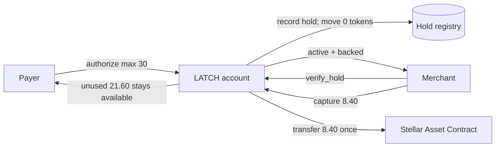

# LATCH

**Authorization holds for Stellar smart accounts — reserve capacity, capture the final amount, keep custody with the payer.**

[](https://github.com/karagozemin/Latch/actions/workflows/ci.yml)


Cards can reserve money without charging it. Most token payment flows cannot.
They make the payer transfer the maximum up front, fund an escrow, or grant an
allowance that may no longer be backed when the merchant settles.

LATCH adds the missing payment state between **not paid** and **paid**. A payer
authorizes a merchant-specific ceiling and expiry inside their own Stellar
contract account. The merchant can verify that capacity on-chain and later
settle once, up to the ceiling. Until capture, no token moves and the merchant
never has custody of the reserved amount.

> **A spending limit asks “may this account spend?” LATCH answers “will this
> amount still be here for this merchant?”**

Built as an early prototype for HackMeridian 2026. The intended Genesis
category remains subject to organizer confirmation because meaningful protocol
and contract work predates the official build window.

## The product in 30 seconds



The account continuously enforces one rule:

```text
backing   = min(internal mirror, real token balance)
available = max(0, backing - sum(active, non-expired holds))

new hold <= available
direct payment <= available
```

That invariant is enforced twice where it matters: the custom-account
authorization policy checks internal state, and contract execution checks the
lower of mirrored and real token backing.

Read the full [architecture, state machine, and trust boundaries](./docs/ARCHITECTURE.md).

## Verified today

This repository does not rely on screenshots or a mocked happy path. It includes
a reproducible Testnet lifecycle and links every successful state transition to
public chain evidence.

| Evidence | Result |
|---|---|
| Production contract | 15 lifecycle, authorization, event, attack, and invariant tests |
| Host assumptions | 14 tests across five isolated Soroban behavior spikes |
| Frontend | 12 deterministic state, request, retry, persistence, and responsive-control tests |
| Public Testnet contract | [`CCWSZPG5…NP7LC`](https://stellar.expert/explorer/testnet/contract/CCWSZPG5PLKCKKUBDN6WI6XHPYZJIQVGZSBGYF27PSS5GWH4HYENP7LC) |
| Optimized WASM | `15,156 bytes` · SHA-256 `d80feb4f…f3a590d` |
| Typed client | Generated from the deployed contract ABI; drift-checked in CI |
| Judge replay | 30/30 automated full-flow rehearsals passed |
| CI | Format, Clippy, contract/spike/frontend tests, ABI drift, builds, and bundle drift |

The machine-readable proof manifest is
[`deployments/testnet.json`](./deployments/testnet.json). The threat-to-test
mapping is in [`docs/SECURITY-EVIDENCE.md`](./docs/SECURITY-EVIDENCE.md).

## Canonical Testnet proof

One 50 LUSD balance supports two merchants without moving funds at authorization:

| Step | Balance | Reserved | Available | What the chain proves |
|---|---:|---:|---:|---|
| Deposit | 50.00 | 0.00 | 50.00 | LATCH is funded |
| Hotel hold | 50.00 | 30.00 | 20.00 | 30 is merchant-bound |
| Fuel hold | 50.00 | 45.00 | 5.00 | Concurrent claims share one honest capacity |
| Attempt to pay 10 | 50.00 | 45.00 | 5.00 | Simulation rejects; before/after state is identical |
| Pay 4 | 46.00 | 45.00 | 1.00 | Unreserved balance remains usable |
| Hotel captures 8.40 | 37.60 | 15.00 | 22.60 | 8.40 settles; unused 21.60 is released |
| Fuel releases 15 | 37.60 | 0.00 | 37.60 | The second reservation returns immediately |

Public transactions:
[deposit](https://stellar.expert/explorer/testnet/tx/d9ef93d2d6ece78a407b26d814d7cd2721dc33e2e240cff61f5172a3fe93fc25) ·
[hold 30](https://stellar.expert/explorer/testnet/tx/f2c87a278a7bde8ac47be189e97892252e2b9c90aeda0726c63295a2ce152074) ·
[hold 15](https://stellar.expert/explorer/testnet/tx/b0be04a6a50b9bbc2ddea45186baaee3ba6f13a2950a433d8400f3c2fe7463e7) ·
[pay 4](https://stellar.expert/explorer/testnet/tx/087615b0058ac28bb7dcd4e1436e2736bd677347e1c3c3d1d1d2c7b1f3165b7b) ·
[capture 8.40](https://stellar.expert/explorer/testnet/tx/4e90adf522314bf98499ffd2563a730d80d9edb74739aa932168bb63f344b3aa) ·
[release 15](https://stellar.expert/explorer/testnet/tx/39c466d6a8603fa30541fda8eb82cf88cfb552524469c32c7cee79cbe7638674).

The rejected 10 LUSD attempt has no transaction hash by design: typed
simulation rejects it before signing or submission. The manifest records the
unchanged on-chain balance and available capacity before and after the attempt.

## Demo modes

The interface has two deliberately different proof modes:

- **Verified replay** presents the canonical two-merchant LUSD lifecycle above,
  including request QR codes, payer approval/decline, accounting transitions,
  and the exact public Testnet links.
- **Live wallet** lets a judge use Freighter on Testnet to deploy a fresh LATCH
  account, deposit 50 XLM, create a 30 XLM hold, prove an overspend rejection,
  pay safely, and capture or release. This is intentionally a one-wallet
  stage-safe fallback, not a claim that the current UI is a production
  two-device merchant integration.

The temporary hosted preview is access-restricted. The final public production
deployment will be published on Vercel after the release build is frozen. Until
then, run the demo locally using the instructions below.

## Why this belongs at the account layer

An allowance grants permission but does not reserve capacity. Escrow reserves
capacity by moving funds into another contract. LATCH makes reservation a rule
of the payer's own account:

| Property | Allowance | Per-deal escrow | LATCH |
|---|:---:|:---:|:---:|
| Tokens move at authorization | No | Yes | No |
| Capacity remains backed | No | Yes | Yes, against payer spend |
| Bound to one merchant | Sometimes | Yes | Yes |
| Multiple claims share one balance | Unbacked | Usually fragmented | Yes |
| Third-party custody before capture | No | Yes | No |
| Payer can spend through the promise | Yes | No | No |

LATCH's guarantee is intentionally precise: it prevents the **payer** from
spending reserved capacity. It cannot override issuer clawback, freeze, or
network-level controls. `verify_hold` reports `guaranteed: false` if real token
backing falls below active reservations, rather than displaying a stale promise.

## Contract surface

| Method | Authority | Effect |
|---|---|---|
| `deposit(from, amount)` | `from` | Transfers the configured asset into LATCH and updates its mirror |
| `create_hold(merchant, maximum, expires_at, reference)` | LATCH owner via custom-account auth | Records a merchant-bound reservation; transfers nothing |
| `pay(to, amount)` | LATCH owner via custom-account auth | Transfers only unreserved capacity |
| `capture(id, amount)` | Bound merchant | Settles once, up to the ceiling, and releases the difference |
| `void(id)` | Bound merchant | Terminates the hold without transferring funds |
| `verify_hold(id)` | Read-only | Returns active/backed status and the committed terms |
| `sync()` | Permissionless | Reconciles the mirror to the real token balance |

The custom account defaults to deny. Owner authorization permits only LATCH
self-calls to `pay` and `create_hold`; their typed function bodies validate the
arguments. Direct token calls, unrelated contract calls, and contract-creation
contexts are rejected.

## Repository map

```text
contracts/latch/           production Soroban custom-account contract
packages/latch-client/     generated TypeScript ABI client
sites/latch-demo/          responsive payer + merchant judge interface
scripts/testnet/            reproducible Testnet deployment and lifecycle proof
deployments/testnet.json   current public proof manifest
spike-*                    isolated Soroban host-behavior experiments
docs/                      architecture, security, demo, pitch, and submission evidence
```

Important reading:

- [Architecture](./docs/ARCHITECTURE.md) — components, invariants, auth path,
  lifecycle, trust boundaries, and failure semantics
- [Security evidence](./docs/SECURITY-EVIDENCE.md) — each threat mapped to a
  contract control and executable test
- [Locked PRD](./LATCH-PRD.md) — product requirements and original scope
- [Product decisions](./docs/PRODUCT-DECISIONS.md) — shipped decisions that
  supersede older PRD proposals
- [Demo runbook](./docs/DEMO-RUNBOOK.md) — stage flow and failure ladder
- [Submission pack](./docs/SUBMISSION-PACK.md) — truthful claims and video script

## Run locally

### Prerequisites

- Node.js `22.12+`
- npm
- Rust stable
- Rust target `wasm32v1-none`
- Stellar CLI `27.0.0` for WASM/client/Testnet workflows
- Chrome + Freighter on Testnet only for the live-wallet path

### Install and verify

```sh
npm ci
npm ci --prefix sites/latch-demo

cargo fmt --all --check
cargo clippy --workspace --all-targets --all-features -- -D warnings
cargo test --workspace --all-features
npm run lint --prefix sites/latch-demo
npm test --prefix sites/latch-demo
npm run build:site
```

Run the five protocol spike suites:

```sh
for crate in spike-reentry spike-s1 spike-s2 spike-s3 spike-s6; do
  CARGO_TARGET_DIR="$PWD/target/protocol-spikes" \
    cargo test --manifest-path "$crate/Cargo.toml" --all-features
done
```

Serve the built demo:

```sh
python3 -m http.server 4173 -d sites/latch-demo/dist
```

Then open <http://127.0.0.1:4173>.

### Reproduce the chain proof

The bootstrap command builds and optimizes the contract, regenerates the typed
client, creates isolated local Stellar CLI identities, funds them on Testnet,
deploys a fresh contract, runs the complete lifecycle, verifies final state,
and rewrites the proof manifest.

```sh
npm run testnet:bootstrap
```

Local secret keys stay in Stellar CLI configuration. They are read into memory
for signing and are never written to this repository or the deployment manifest.

## Security posture

- Default-deny custom-account authorization
- Function allowlist for owner-authorized operations, plus typed body validation
- Merchant binding on capture and void
- `min(mirror, real balance)` backing checks during execution
- Checked arithmetic and positive/non-negative amount validation
- Maximum 16 active holds and 64 stored hold records before compaction
- Maximum hold duration of 120,960 ledgers
- Terminal state prevents replayed capture or release
- Event payloads expose the accounting facts used by the demo

For limitations, attack coverage, and why the balance mirror exists, see the
[architecture document](./docs/ARCHITECTURE.md) and
[security evidence matrix](./docs/SECURITY-EVIDENCE.md).

## Honest limitations

- Genesis v1 supports one configured asset per LATCH account.
- A hold has one terminal settlement: capture once or release once. Repeated
  partial captures are not implemented.
- The payer cannot cancel a live hold; the bound merchant can release it, or it
  expires by ledger sequence.
- The payer-side guarantee cannot override issuer clawback/freeze. During a
  network outage the on-chain reservation persists, but clients cannot freshly
  verify or settle it until connectivity returns.
- The live demo currently uses one Freighter wallet for payer and merchant to
  reduce stage risk. The contract itself enforces merchant binding, and the
  replay/QR experience demonstrates the two-party product flow.
- Contract-account muxed transfers are not supported uniformly across all
  wallets and exchanges.
- This prototype has extensive automated evidence but has not undergone an
  independent production security audit.

## Roadmap

1. Ship a real two-device payer/merchant handoff around the existing request QR.
2. Add partial capture with explicit residual-reservation accounting.
3. Support multiple configured assets and merchant SDKs for POS integrations.
4. Package the reservation rule as a reusable smart-account policy module.
5. Explore reserved `upto` capacity for x402-style deferred settlement.
