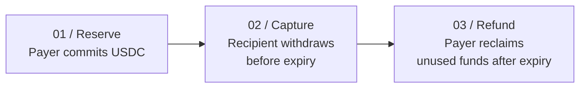

<p align="center">
  
</p>

# LATCH

### Programmable USDC authorization holds on Arc.

**Reserve now. Capture what is owed. Reclaim what is unused.**

LATCH is an onchain payment authorization primitive that separates **committing funds** from **settling a payment**. A payer reserves USDC for a designated recipient, the recipient captures funds before an expiry, and the payer can reclaim any unused balance afterward.

Built with [Arc Studio](https://studio.arc.io). Deployed on Arc Mainnet.

[**Architecture →**](docs/ARCHITECTURE.md) · [Smart Contract](contracts/Latch.sol) · [Deployments](docs/reference/DEPLOYMENTS.md) · [Security](docs/reference/SECURITY.md) · [Demo](docs/guides/DEMO.md)

---

## The problem

Most onchain payments are final as soon as the transfer executes.

That makes sense when the price is known and the work is already complete. It is less useful when the final amount depends on what happens next.

Consider usage-based APIs, service providers, or work that is settled after delivery. Paying everything upfront exposes the payer to non-delivery. Paying afterward leaves the recipient with no funds committed in advance.

**LATCH introduces a third option: authorize a maximum amount first, then settle only the amount actually required.**

The authorization is backed by USDC held in a smart contract—not a promise to pay later.

## How it works



Each authorization has four core properties: a **payer**, a **recipient**, a **reserved amount**, and an **expiration timestamp**.

| Operation | Caller | Behavior |
| :--- | :--- | :--- |
| `createHold()` | Payer | Locks approved USDC for a designated recipient until a specified expiry. |
| `capture()` | Recipient | Withdraws any amount up to the remaining balance, strictly before expiry. Partial captures are supported. |
| `refundExpired()` | Payer | Returns the unused balance after expiry. |

### An example

A payer reserves **$10 in USDC** for a service.

The service provider completes work worth **$6** and captures that amount before the authorization expires.

After expiry, the payer claims the remaining **$4**.

| | Amount |
| :--- | ---: |
| Authorized | 10.00 USDC |
| Captured by recipient | 6.00 USDC |
| Refunded to payer | 4.00 USDC |
| Platform fee | 0.00 USDC |

This is an illustrative example. Refunds are **not automatic**: the payer must submit the refund transaction after expiry. If the entire balance has already been captured, there is nothing left to refund.

## Design principles

LATCH is intentionally small.

**Fully funded authorizations.** A hold is backed by USDC transferred into the contract at creation. Recipients do not depend on a future payment approval.

**Partial settlement.** A recipient can capture funds in multiple transactions while an authorization remains active.

**Explicit permissions.** Only the designated recipient can capture. Only the original payer can refund, and only after expiry.

**No privileged operator.** The contract has no owner, administrative withdrawal, upgrade mechanism, or protocol fee.

**Deterministic accounting.** Every hold maintains the following invariant:

```text
deposited = captured + refunded + remaining
```

**Immutable settlement rules.** Neither party can unilaterally change the recipient or expiry after a hold is created.

These choices deliberately keep LATCH focused on a single primitive rather than combining authorization with invoicing, arbitration, reputation, or a marketplace.

## Architecture

LATCH consists of two main pieces:

- **Onchain:** An immutable Solidity contract that holds USDC, enforces the authorization rules, maintains per-hold accounting, and emits settlement events.
- **Frontend:** A React application that connects to wallets, submits transactions, reads authorizations, and displays activity.

The frontend uses **wagmi** and **viem** to communicate with Arc. It does not require a proprietary backend, database, or transaction relayer.

```text
User Wallet
    │
    ▼
React / Vite Dashboard
    │
    ▼
wagmi + viem
    │
    ▼
Arc RPC
    │
    ├── LATCH Contract
    │       └── Authorization state + settlement rules
    │
    └── Arc USDC
            └── Token transfers
```

For detailed diagrams, contract state transitions, data flow, event indexing limitations, and architectural decisions:

**[Explore the complete architecture →](docs/ARCHITECTURE.md)**

## Deployed contracts

LATCH is deployed on both Arc Mainnet and Arc Testnet.

| Network | Chain ID | Contract |
| :--- | ---: | :--- |
| **Arc Mainnet** | `5042` | [`0xd09E...7CC2`](https://explorer.arc.io/address/0xd09EAC2f4eF49A5E918bB49884189c37793a7CC2) |
| **Arc Testnet** | `5042002` | [`0xdb90...a3b`](https://explorer.testnet.arc.io/address/0xdb90ccaee5b1c63139de9d01fd93b8c0c3665a3b) |

The contract uses Arc's USDC ERC-20 interface at:

`0x3600000000000000000000000000000000000000`

USDC amounts use six decimal places.

**Mainnet deployment:** [View transaction](https://explorer.arc.io/tx/0xea0747048d177ce7b48830dbcb61b045b1fe63715e3098660bc565d36349cec6) · Block `29071512`

The mainnet contract was deployed independently using Foundry. The testnet contract has been exercised with two wallets. Mainnet source verification and the first documented mainnet Reserve/Capture/Refund demonstration are still pending.

[Full deployment details →](docs/reference/DEPLOYMENTS.md)

## Getting started

### Requirements

- [Bun](https://bun.sh)
- [Foundry](https://book.getfoundry.sh)
- An EVM-compatible wallet

### Run the application

```bash
git clone https://github.com/karagozemin/LATCH.git
cd LATCH

bun install
cp .env.example .env
bun run dev
```

The development environment is intended to use Arc Testnet. Set `VITE_LATCH_NETWORK=testnet` in your local `.env` and confirm the testnet contract configuration before connecting a wallet.

The public landing page is available at `http://localhost:5173`; the functional dashboard is at `http://localhost:5173/app`. Dashboard views remain directly addressable with URLs such as `/app?view=holds`.

Production builds use the public Arc Mainnet configuration in `.env.production`. Environment variables beginning with `VITE_` are exposed to browser code and must never contain private keys or signing secrets.

For production hosting, see the [Vercel deployment guide](docs/guides/VERCEL.md).

## Smart contract development

LATCH is implemented in **Solidity 0.8.28** with OpenZeppelin's `SafeERC20` and `ReentrancyGuard`.

Compile and run the contract tests:

```bash
forge build
forge test
```

The Foundry suite contains **65 tests**, covering:

- Authorization creation, partial capture, and refund behavior
- Access control and invalid state transitions
- Expiry boundaries
- Reentrancy attempts
- Fuzzing and accounting invariants

The same suite has also passed using Arc Foundry.

Validate the frontend:

```bash
bun run check
bun run build
```

The production build is generated in `dist/`.

## Project structure

```text
LATCH/
├── contracts/          # Solidity contracts, tests, deployment scripts
├── src/                # Frontend application and Web3 integration
├── scripts/            # Development and Studio tooling
├── docs/
│   ├── ARCHITECTURE.md
│   ├── guides/         # Demo and deployment walkthroughs
│   └── reference/      # Deployment records and security notes
├── foundry.toml
├── package.json
└── README.md
```

This tree shows the main components rather than every configuration file. Some build and dependency files remain at the root to preserve tooling compatibility.

## Documentation

| Resource | Description |
| :--- | :--- |
| [Architecture](docs/ARCHITECTURE.md) | System components, authorization lifecycle, state transitions, and design trade-offs |
| [Demo](docs/guides/DEMO.md) | Walk through Reserve → Capture → Refund |
| [Deployment](docs/guides/DEPLOYMENT.md) | Deploy and verify the smart contract using Foundry |
| [Vercel](docs/guides/VERCEL.md) | Publish the frontend |
| [Deployments](docs/reference/DEPLOYMENTS.md) | Contract addresses, transactions, and deployment records |
| [Security](docs/reference/SECURITY.md) | Trust assumptions, test coverage, and known limitations |

## Security

LATCH is immutable and has no administrative recovery mechanism. That removes privileged operator access but also means that operational mistakes cannot be reversed by an administrator.

The implementation has undergone automated analysis and testing, **not a third-party security audit**.

USDC issuer-level restrictions can affect transfers, and any unclaimed funds remaining after expiry require the payer to initiate a refund transaction.

**Use small amounts until you have independently reviewed the contract and understood its limitations.**

See [Security Notes](docs/reference/SECURITY.md) for more details.

## License

Released under the [MIT License](LICENSE).

---

Built with [Arc Studio](https://studio.arc.io).
