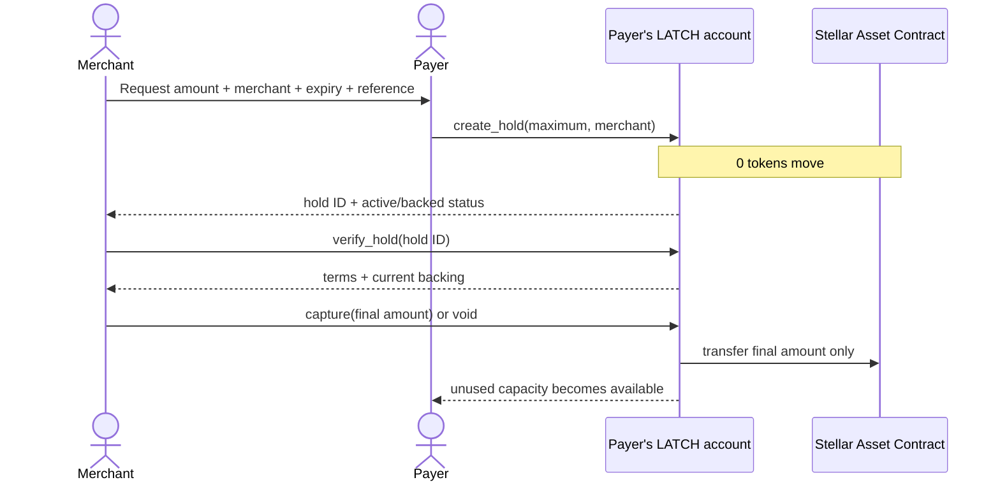

# LATCH

**Merchant-bound payment reservations for Stellar.**

LATCH is a Soroban-native checkout primitive that lets a payer reserve part of
their spendable token balance for one merchant—without paying or moving the
funds at authorization time. The merchant can verify the reservation on-chain,
then capture the final amount once or release it. The payer's own contract
account prevents the reserved capacity from being spent elsewhere.

**Reserve now. Deliver with confidence. Settle only what is owed.**

[](https://github.com/karagozemin/Latch/actions/workflows/ci.yml)


**Working Testnet MVP · public contract · reproducible lifecycle · not independently audited**

LATCH is not escrow: no third party receives the reservation. Its guarantee is
deliberately payer-side—issuer freeze/clawback remains external, and fresh
verification or settlement requires network access.

[Testnet contract](https://stellar.expert/explorer/testnet/contract/CCWSZPG5PLKCKKUBDN6WI6XHPYZJIQVGZSBGYF27PSS5GWH4HYENP7LC)
· [proof manifest](./deployments/testnet.json)
· [architecture](./docs/ARCHITECTURE.md)
· [security evidence](./docs/SECURITY-EVIDENCE.md)

## Why LATCH exists

Many merchants need proof of payment capacity **before** the final charge is
known: a hotel before check-in, a fuel pump before dispensing, or a service
provider before delivery.

Existing approaches force a trade-off:

- **Pay and refund:** the merchant takes funds the payer may never owe.
- **Allowance:** the merchant has permission, but the balance can be spent
  elsewhere before settlement.
- **Per-deal escrow:** capacity is backed by moving funds out of the payer's
  account before the final amount is known.

LATCH adds a fourth state: **merchant-bound reserved capacity inside the
payer-controlled account**. Creating a hold moves zero tokens. Capture moves
only the final amount.

> Wallets initiate payments. Anchors fund and off-ramp assets. Merchant apps
> accept payments. LATCH provides the authorization layer between payer approval
> and deferred merchant settlement.

## The lifecycle



A hold is bound to one merchant and has one terminal outcome:

```text
Active ── capture ──> Captured
   ├────── void ────> Voided
   └───── expiry ───> Expired
```

A captured, voided, or expired hold cannot settle again. A capture below the
ceiling releases the unused capacity atomically.

## Why Soroban smart accounts

LATCH puts the payment rule at the **payer-account layer**, not only in a
merchant-side settlement contract.

The LATCH contract implements Soroban's `CustomAccountInterface`:

- owner-authorized calls default to deny;
- only LATCH `create_hold` and `pay` calls are admitted by the account policy;
- direct token and unrelated contract calls are rejected;
- `pay` cannot consume capacity promised to active holds;
- capture and release authenticate the merchant stored in the hold;
- contract events make reservation and settlement accounting inspectable.

The core invariant is:

```text
backing   = min(internal mirror, real token balance)
available = max(0, backing - sum(active, non-expired holds))

new hold <= available
owner payment <= available
```

The custom-auth layer checks internal reservation state. Contract execution
checks real Stellar Asset Contract backing as well. This split is necessary
because Soroban prevents re-entering the token contract from `__check_auth`.
The repository contains five isolated host-behavior spike suites proving the
runtime assumptions behind that design.

See [Architecture](./docs/ARCHITECTURE.md) for the signing path, mirror rationale,
state model, trust boundaries, and transaction sequences.

## Proof at a glance

The checked-in proof was produced from a fresh Testnet deployment with isolated
owner, payer, and merchant identities. It is not a UI-only simulation.

| Proof | Verifiable result |
|---|---|
| Contract | [`CCWSZPG5…NP7LC`](https://stellar.expert/explorer/testnet/contract/CCWSZPG5PLKCKKUBDN6WI6XHPYZJIQVGZSBGYF27PSS5GWH4HYENP7LC) |
| Lifecycle | Deposit → two holds → rejected overspend → safe pay → capture → release |
| On-chain actors | Distinct owner, payer, primary merchant, and secondary merchant addresses |
| Contract suite | 15 lifecycle, authorization, event, attack, and invariant tests |
| Host assumptions | 14 tests across five isolated Soroban spike crates |
| Frontend suite | 15 state, request, settlement, retry, persistence, and responsive-control tests |
| Rehearsal | 30/30 automated seven-state judge replays passed |
| Reproduction | `npm run testnet:bootstrap` rebuilds, deploys, executes, verifies, and rewrites the manifest |

### Canonical Testnet run

One 50 LUSD balance carries two independent merchant reservations:

| Step | Balance | Reserved | Available | Evidence |
|---|---:|---:|---:|---|
| Deposit | 50.00 | 0.00 | 50.00 | [transaction](https://stellar.expert/explorer/testnet/tx/d9ef93d2d6ece78a407b26d814d7cd2721dc33e2e240cff61f5172a3fe93fc25) |
| Hold 30 | 50.00 | 30.00 | 20.00 | [transaction](https://stellar.expert/explorer/testnet/tx/f2c87a278a7bde8ac47be189e97892252e2b9c90aeda0726c63295a2ce152074) |
| Hold 15 | 50.00 | 45.00 | 5.00 | [transaction](https://stellar.expert/explorer/testnet/tx/b0be04a6a50b9bbc2ddea45186baaee3ba6f13a2950a433d8400f3c2fe7463e7) |
| Attempt pay 10 | 50.00 | 45.00 | 5.00 | Rejected during typed simulation; state unchanged |
| Pay 4 | 46.00 | 45.00 | 1.00 | [transaction](https://stellar.expert/explorer/testnet/tx/087615b0058ac28bb7dcd4e1436e2736bd677347e1c3c3d1d1d2c7b1f3165b7b) |
| Capture 8.40 | 37.60 | 15.00 | 22.60 | [transaction](https://stellar.expert/explorer/testnet/tx/4e90adf522314bf98499ffd2563a730d80d9edb74739aa932168bb63f344b3aa) |
| Release 15 | 37.60 | 0.00 | 37.60 | [transaction](https://stellar.expert/explorer/testnet/tx/39c466d6a8603fa30541fda8eb82cf88cfb552524469c32c7cee79cbe7638674) |

The rejected payment has no transaction hash because it is rejected before
signing or submission. The [proof manifest](./deployments/testnet.json) records
the same balance and available capacity before and after the attempt.

## Security evidence

| Risk | Control | Executable evidence |
|---|---|---|
| Payer spends reserved capacity | Hold-aware custom authorization plus execution-time backing check | `full_hold_lifecycle_preserves_capacity` |
| Wrong merchant settles | Stored merchant must authenticate capture and void | `only_the_bound_merchant_can_capture` |
| Hold settles twice | Captured/voided/expired states are terminal | `terminal_holds_cannot_transition_twice` |
| Mirror overstates backing | Execution uses `min(mirror, real balance)` | `clawback_cannot_spend_reserved_capacity` |
| Hold remains indefinitely | Ledger expiry plus 120,960-ledger duration cap | `expiry_releases_capacity_without_a_write` |
| State grows without bound | 16 active / 64 stored limits and compaction | `active_hold_count_is_bounded` |

All named tests live in
[`contracts/latch/src/test.rs`](./contracts/latch/src/test.rs). The complete
[security evidence matrix](./docs/SECURITY-EVIDENCE.md) maps every threat to its
control, test, and known boundary.

## Demo and roles

The product models two distinct roles:

- **Payer:** reviews a merchant request and authorizes a hold from a LATCH
  account.
- **Merchant:** creates the request, verifies the hold, then captures or
  releases it.

The live interface implements a two-party handoff without a trusted backend:

1. The merchant creates an amount/expiry/reference request and shares its QR or
   URL with the payer.
2. A different payer wallet authorizes the hold from its own LATCH account.
3. The payer returns a settlement QR/URL carrying the account and hold ID.
4. The bound merchant reconnects, re-reads the hold from Testnet, and verifies
   merchant, ceiling, expiry, and the original request hash before capture or
   release controls unlock.

The links are transports, not authority. Freighter signatures and fresh
contract reads remain the authorization and verification boundaries.

It exposes two honest proof modes:

- **Verified replay:** the canonical two-merchant LUSD flow, backed by the public
  transaction manifest.
- **Live wallet:** separate merchant and payer browser profiles exchange request
  and settlement links while Freighter submits real Testnet XLM calls. A
  one-wallet path remains available only as a labeled stage-recovery option.

The final public frontend will be deployed to Vercel after the release build is
frozen. Until then, run it locally.

## Reproduce it

### Requirements

- Node.js `22.12+` and npm
- Rust stable with `wasm32v1-none`
- Stellar CLI `27.0.0`
- Chrome and Freighter on Testnet for the live-wallet path

### Install, test, and build

```sh
npm ci
npm ci --prefix sites/latch-demo

cargo fmt --all --check
cargo clippy --workspace --all-targets --all-features -- -D warnings
cargo test --workspace --all-features
npm run lint --prefix sites/latch-demo
npm test --prefix sites/latch-demo
npm run build:site
```

Run the built frontend:

```sh
python3 -m http.server 4173 -d sites/latch-demo/dist
```

Open <http://127.0.0.1:4173>.

### Fresh Testnet lifecycle

```sh
npm run testnet:bootstrap
```

This builds and optimizes the contract, regenerates the typed client, creates
isolated identities, funds them on Testnet, deploys a fresh LATCH account,
executes the complete lifecycle, verifies final state, and rewrites
`deployments/testnet.json`. Secret keys remain in local Stellar CLI
configuration and are never committed or written to the manifest.

## Contract API

| Method | Authority | Result |
|---|---|---|
| `deposit(from, amount)` | Funding address | Moves the configured asset into LATCH |
| `create_hold(merchant, maximum, expires_at, reference)` | LATCH owner | Reserves capacity; moves zero tokens |
| `pay(to, amount)` | LATCH owner | Transfers only unreserved capacity |
| `verify_hold(id)` | Read-only | Returns terms plus current active/backed status |
| `capture(id, amount)` | Bound merchant | Settles once and releases the unused ceiling |
| `void(id)` | Bound merchant | Releases the hold without settlement |
| `sync()` | Permissionless | Reconciles the mirror with real token balance |

The TypeScript ABI client in [`packages/latch-client`](./packages/latch-client)
is generated from the final optimized WASM. CI regenerates it and fails on drift.

## Repository map

```text
contracts/latch/           Soroban custom-account contract
packages/latch-client/     generated TypeScript ABI client
sites/latch-demo/          payer + merchant judge interface
scripts/testnet/            fresh Testnet deployment and proof runner
deployments/testnet.json   machine-readable public proof
spike-*                    isolated Soroban host-behavior experiments
docs/                      architecture, security, demo, and submission evidence
```

## Deliberate v1 boundaries

LATCH is a Testnet prototype, not a card-network guarantee or an audited
production payment rail.

- One configured asset per LATCH account.
- One terminal settlement per hold; repeated partial capture is not implemented.
- Merchant release plus deterministic expiry; payer cancellation is excluded to
  avoid introducing a fulfillment/cancellation race without a dispute model.
- Payer-side reservation cannot override issuer freeze or clawback.
- During a network outage the reservation remains on-chain, but it cannot be
  freshly verified or settled until connectivity returns.
- Contract-account muxed transfers are not uniformly supported by wallets and
  exchanges.

One-shot capture and deterministic expiry are intentional: they keep settlement,
accounting, and replay behavior small enough to audit and demonstrate clearly.
See [Product decisions](./docs/PRODUCT-DECISIONS.md).

## Planned next steps

1. Merchant integration helpers over the generated ABI client.
2. Event/indexer-backed status history for merchant operations.
3. Partial capture with explicit residual-reservation accounting.
4. Multi-asset account policy and POS integration adapters.
5. Exploration of reserved capacity for x402-style deferred settlement.

## Three-minute judge path

1. Inspect the [public contract](https://stellar.expert/explorer/testnet/contract/CCWSZPG5PLKCKKUBDN6WI6XHPYZJIQVGZSBGYF27PSS5GWH4HYENP7LC)
   and [proof manifest](./deployments/testnet.json).
2. Read the [architecture](./docs/ARCHITECTURE.md) and
   [security evidence](./docs/SECURITY-EVIDENCE.md).
3. Run the deterministic UI locally, or reproduce the entire public lifecycle
   with `npm run testnet:bootstrap`.

LATCH's claim is deliberately narrow and verifiable: **a Soroban contract
account can reserve merchant-bound payment capacity, keep funds payer-controlled
until settlement, and prevent the payer from spending through that reservation.**
