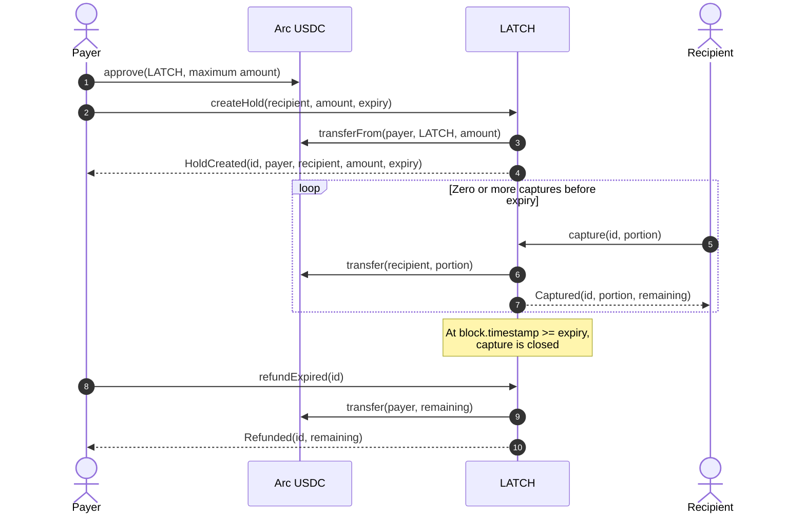
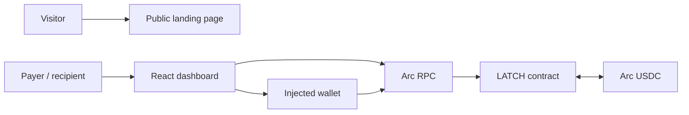

<p align="center">
  
</p>

<h1 align="center">LATCH</h1>

<p align="center">
  <strong>Authorize first. Settle only what is owed.</strong><br />
  Fully funded, programmable USDC payment authorizations on Arc.
</p>

<p align="center">
  <a href="https://latch-arc.vercel.app/app"><strong>Launch App</strong></a> ·
  <a href="docs/ARCHITECTURE.md">Architecture</a> ·
  <a href="contracts/Latch.sol">Contract</a> ·
  <a href="docs/reference/DEPLOYMENTS.md">Deployments</a> ·
  <a href="docs/reference/SECURITY.md">Security</a> ·
  <a href="docs/guides/DEMO.md">Demo</a>
</p>

---

## What is LATCH?

LATCH is a minimal onchain payment-authorization primitive. A payer escrows USDC for one recipient and chooses an expiry. The recipient may capture some or all of that balance before expiry; at or after expiry, the payer may reclaim anything left.

The authorization is a funded position, not a promise to pay later. Settlement rules are enforced by an immutable smart contract with no owner, upgrade path, protocol fee, administrative withdrawal, or offchain operator.

### At a glance

| Property | LATCH |
| --- | --- |
| Settlement asset | Arc USDC, ERC-20 interface, 6 decimals |
| Funding model | Fully collateralized at authorization creation |
| Settlement | Recipient-controlled partial or full captures before expiry |
| Remainder | Payer-triggered refund at or after expiry; never automatic |
| Privileged roles | None |
| Protocol fees | None |
| Upgradeability | None |
| Backend / database / relayer | None |
| Read model | Direct contract reads and RPC event logs |
| Contract build | Solidity source `^0.8.20`, pinned to solc `0.8.28` |
| Test suite | 65 Foundry tests: unit, reverts, fuzzing, reentrancy, invariants |

### The problem

Immediate transfers work well when the amount is known and delivery is complete. They are a poor fit when usage is variable, work is delivered over time, or the final charge is determined later.

| Model | Payer assurance | Recipient assurance | Final amount |
| --- | --- | --- | --- |
| Pay everything upfront | Low after transfer | High | Fixed before delivery |
| Pay only after delivery | High until payment | Low | Known after delivery |
| Authorize with LATCH | Unused funds remain reclaimable | USDC is already escrowed | Captured incrementally up to a funded maximum |

### The solution

LATCH adds a narrow layer between commitment and settlement: funds are available, permissions are explicit, and only the earned amount needs to move to the recipient.

Possible applications include usage-based API billing, service-provider authorizations, and variable-cost onchain commerce. These are protocol capabilities, not claims of existing integrations.

## How it works



### Contract operations

| Function | Authorized caller | Time condition | Result |
| --- | --- | --- | --- |
| `createHold(recipient, amount, expiry)` | Any payer | `expiry > block.timestamp` | Pulls exactly `amount` USDC into LATCH and creates the next sequential hold ID |
| `capture(holdId, amount)` | Designated recipient | `block.timestamp < expiry` | Transfers a nonzero amount up to the remaining balance to the recipient |
| `refundExpired(holdId)` | Original payer | `block.timestamp >= expiry` | Transfers the entire remaining balance back to the payer |

Capture and refund windows never overlap. The boundary timestamp belongs to the refund side.

### Accounting model

Every hold stores its original deposit and cumulative settlement amounts. Its unspent balance is derived rather than independently mutable:

```text
remaining = deposited - captured - refunded

deposited = captured + refunded + remaining
```

The invariant is checked per hold and globally by handler-based Foundry invariant tests. A full capture ends in `Captured`; an expiry refund ends in `Refunded`. Time passing alone never changes contract storage: an **Expired** label in the interface means a stored `Active` hold whose deadline has passed.

### Example

A payer authorizes `10.00 USDC`. The recipient completes work worth `6.00 USDC` and captures it before expiry. After expiry, the payer submits a refund transaction for the remaining `4.00 USDC`.

| Outcome | Amount |
| --- | ---: |
| Deposited | 10.00 USDC |
| Captured | 6.00 USDC |
| Refunded | 4.00 USDC |
| Protocol fee | 0.00 USDC |
| Remaining | 0.00 USDC |

### Guarantees and boundaries

#### Enforced by the contract

- A hold is funded before it exists; `createHold` rejects an unexpected token balance delta.
- Only the named recipient can capture, and only before expiry.
- Only the payer can refund, and only at or after expiry.
- Capture cannot exceed the hold's remaining balance.
- State is updated before external token transfers, every write is `nonReentrant`, and transfers use OpenZeppelin `SafeERC20`.
- No administrator can redirect, withdraw, pause, upgrade, extend, cancel, or rescue holds.

#### Deliberately not provided

- Automatic refunds, scheduled execution, relaying, or keepers
- Cancellation before expiry, expiry extension, top-ups, or recipient replacement
- Arbitration, delivery verification, invoices, subscriptions, or reputation
- Recovery for tokens sent directly to the contract outside `createHold`
- Protection from Arc USDC issuer controls such as pausing or blocklisting

Immutability removes privileged control; it also removes administrative recovery. That trade-off is intentional.

## Architecture

LATCH has two runtime components:

1. **An immutable contract** that escrows USDC, stores hold accounting, enforces permissions and timing, and emits events.
2. **A static browser application** that reads Arc RPC data and asks an injected wallet to sign transactions.

There is no application server, database, indexer, custody service, or relayer.



The public landing page is served at `/`. The wallet-enabled dashboard is lazy-loaded at `/app`, so marketing-page visitors do not load the Web3 provider stack. Dashboard subviews remain shareable through `?view=overview|create|holds|history`.

The dashboard reads the newest 60 holds every five seconds. Activity history scans contract events in adaptive RPC ranges, bounded by the configured deployment block and a 100,000-block maximum lookback. These are interface limits, not protocol limits; every hold remains available through the contract.

For component boundaries, data flows, trust assumptions, failure modes, build behavior, and design decisions, read the **[complete architecture document](docs/ARCHITECTURE.md)**.

## Live deployment

| Network | Chain ID | LATCH | Deployment |
| --- | ---: | --- | --- |
| Arc Mainnet | `5042` | [`0xd09E...7CC2`](https://explorer.arc.io/address/0xd09EAC2f4eF49A5E918bB49884189c37793a7CC2) | [tx](https://explorer.arc.io/tx/0xea0747048d177ce7b48830dbcb61b045b1fe63715e3098660bc565d36349cec6), block `29071512` |
| Arc Testnet | `5042002` | [`0xdb90...a3b`](https://explorer.testnet.arc.io/address/0xdb90ccaee5b1c63139de9d01fd93b8c0c3665a3b) | [tx](https://explorer.testnet.arc.io/tx/0xdcab033de2bbd2733dfa0873b9ad6541861fdcb464d99bbd4093a85a874a5fb0), block `70172256` |

Both networks expose Arc USDC through the ERC-20 interface at:

```text
0x3600000000000000000000000000000000000000
```

The production frontend selects mainnet from the committed `.env.production`; local development defaults to testnet unless configured otherwise. Network, contract, explorer links, wallet switching, USDC facts, and activity scan start block all derive from the same build-time selection.

The mainnet deployment was performed independently by the owner outside Arc Studio. Its source verification, byte-for-byte deployed runtime comparison, and first recorded mainnet authorization lifecycle remain pending. Do not infer completion from the presence of a deployment transaction. See [Deployment records](docs/reference/DEPLOYMENTS.md).

## Quick start & testing

### Requirements

- [Bun](https://bun.sh)
- [Foundry](https://book.getfoundry.sh)
- An injected EVM wallet for browser interactions

### Install and run

```bash
git clone https://github.com/karagozemin/LATCH.git
cd LATCH
bun install
cp .env.example .env
bun run dev
```

Open:

- `http://localhost:5173/` — public landing page
- `http://localhost:5173/app` — dashboard
- `http://localhost:5173/app?view=holds` — direct Active Holds view

Local development should target Arc Testnet. Confirm the values in `.env` before connecting a wallet. All `VITE_*` variables are public browser configuration and must never contain keys, secrets, or signing material.

### Build and verify

```bash
# Frontend
bun run typecheck
bun run build

# Contract
bun run contracts:build
bun run contracts:test
```

`bun run check` runs the configured frontend lint and type checks. `bun run build` emits the static site to `dist/`, including the separately compiled `latch.css` stylesheet.

### Environment configuration

| Variable | Meaning |
| --- | --- |
| `VITE_LATCH_NETWORK` | `testnet` or `mainnet` |
| `VITE_LATCH_ADDRESS_TESTNET` | Testnet contract address |
| `VITE_LATCH_DEPLOY_BLOCK_TESTNET` | Testnet deployment block for bounded event scanning |
| `VITE_LATCH_ADDRESS_MAINNET` | Mainnet contract address |
| `VITE_LATCH_DEPLOY_BLOCK_MAINNET` | Mainnet deployment block for bounded event scanning |

Production configuration fails closed: a missing/invalid address, invalid block, unknown network, or known cross-network address produces a visible configuration error and no contract interaction. It never silently falls back from mainnet to testnet.

### Testing

The current Foundry suite contains **65 tests** across four suites:

| Class | Count | Coverage focus |
| --- | ---: | --- |
| Unit and behavior | 20 | Creation, partial/full capture, refund, events, exact demo flow, token quirks, reentrancy |
| Revert paths | 32 | Caller permissions, time boundaries, unknown holds, insufficient funds/allowance, terminal states |
| Fuzz | 7 | Arbitrary amounts, expiries, capture sequences, multi-hold conservation |
| Handler invariants | 6 | Global/per-hold accounting, token conservation, authorization safety, hold-count consistency |

The invariant suite runs 256 campaigns with 128,000 handler calls per invariant. The suite passes with standard Foundry; project records also document a pass under Arc Foundry. Automated testing and static analysis are evidence, not an audit.

Compiler configuration is pinned in `foundry.toml`: solc `0.8.28`, optimizer enabled with 200 runs, EVM target `cancun`. The recorded SHA-256 of `contracts/Latch.sol` is:

```text
0b889effdbb2a1fefbb27d845f773465fa93b55b3ff3e37bf01096ac998d2d9f
```

### Repository map

```text
LATCH/
├── contracts/
│   ├── Latch.sol                 # Protocol implementation
│   ├── script/DeployLatch.s.sol  # Chain and USDC-checked Foundry deploy script
│   └── test/                     # Unit, revert, fuzz, and invariant suites
├── src/
│   ├── assets/                    # Brand assets
│   ├── LandingPage.tsx           # Public route (/)
│   ├── DashboardRoot.tsx         # Lazy Web3 provider boundary (/app)
│   ├── App.tsx                   # Dashboard composition
│   ├── components/               # Landing and dashboard UI
│   ├── hooks/                    # Holds, activity, transaction state
│   └── lib/latch.ts              # ABI, network selection, derived hold state
├── docs/
│   ├── ARCHITECTURE.md           # Technical system design
│   ├── guides/                   # Demo, deployment, and hosting runbooks
│   └── reference/                # Security and deployment evidence
├── tooling/                      # Vite, TypeScript, lint, CSS, and helper scripts
├── foundry.toml
├── package.json
└── vercel.json
```

Only files required by package managers, Foundry, Vercel, Vite's HTML entry, and repository tooling remain at the root. Supporting configuration and helper scripts live under `tooling/`; Solidity dependencies live under `contracts/lib/`.

## Security & documentation

| Document | Purpose |
| --- | --- |
| [Architecture](docs/ARCHITECTURE.md) | System context, contract state machine, frontend read/write models, trust boundaries, failure handling, decisions |
| [Security](docs/reference/SECURITY.md) | Security posture, test evidence, trust assumptions, known limitations |
| [Deployments](docs/reference/DEPLOYMENTS.md) | Addresses, deployment transactions, compiler settings, evidence, pending verification work |
| [Demo](docs/guides/DEMO.md) | Testnet Reserve → Capture → Refund walkthrough |
| [Contract deployment](docs/guides/DEPLOYMENT.md) | Foundry mainnet deployment and verification runbook |
| [Vercel](docs/guides/VERCEL.md) | Static frontend deployment and route checks |

### Security

- The contract is immutable and cannot be paused or repaired by an administrator.
- The frontend is not a security boundary; the contract validates every caller, amount, state, and time condition.
- Arc USDC issuer controls and transfer failures remain external dependencies.
- Refunds require a payer transaction. Funds can remain escrowed indefinitely if the payer never submits it.
- Direct USDC transfers to the contract are outside hold accounting and are unrecoverable.
- The interface intentionally shows only a bounded recent view of holds and events.

Report suspected vulnerabilities privately when disclosure could put funds at risk. For the complete posture, see [Security Notes](docs/reference/SECURITY.md).

## License

Released under the [MIT License](LICENSE).

---

Built with [Arc Studio](https://studio.arc.io).
