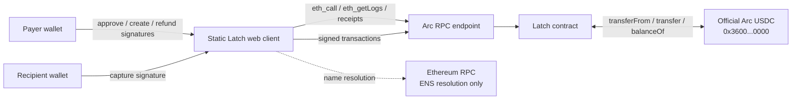
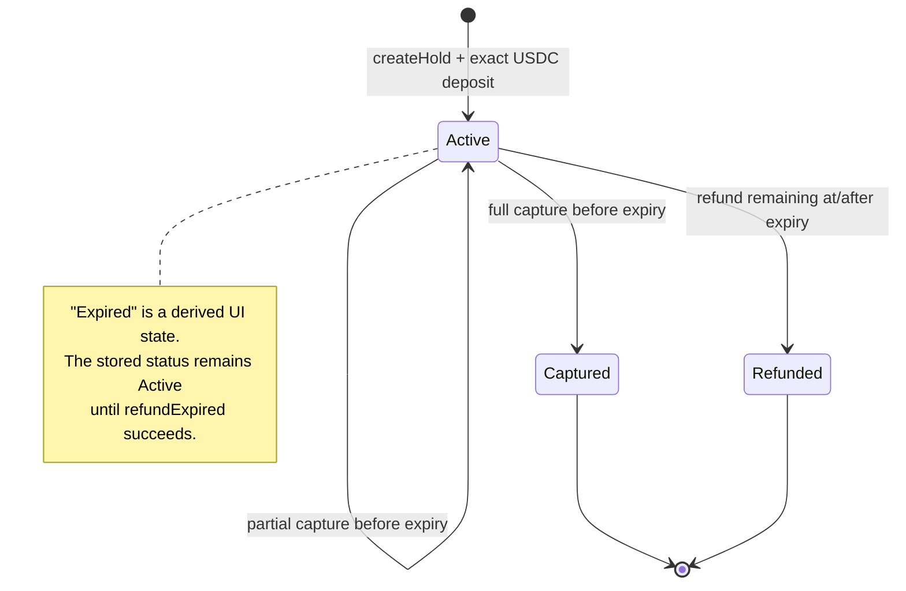
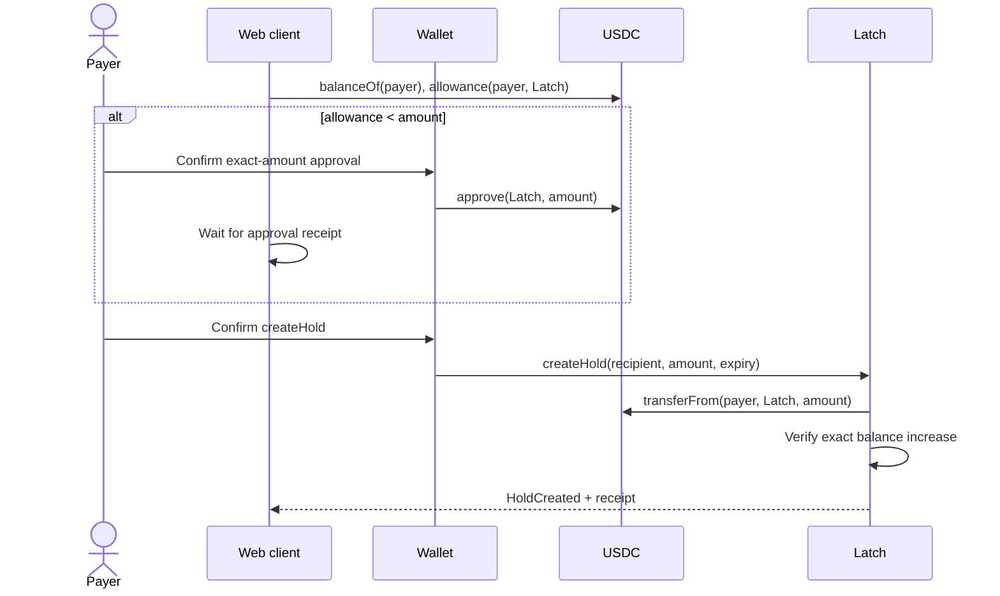
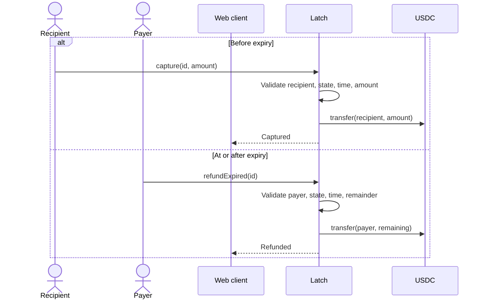

# Latch Architecture

> Technical reference for the Latch protocol, web client, data flows, trust boundaries, and operational constraints.

[README](../README.md) · [Security](reference/SECURITY.md) · [Deployments](reference/DEPLOYMENTS.md) · [Deployment guide](guides/DEPLOYMENT.md)

---

## 1. Document status

| Field | Value |
| --- | --- |
| System | Latch |
| Protocol | Immutable prepaid USDC payment authorizations |
| Target chains | Arc Testnet (`5042002`) and Arc Mainnet (`5042`) |
| Contract source | [`contracts/Latch.sol`](../contracts/Latch.sol) |
| Frontend entry point | [`src/main.tsx`](../src/main.tsx) |
| Solidity source hash | `0b889effdbb2a1fefbb27d845f773465fa93b55b3ff3e37bf01096ac998d2d9f` (SHA-256) |
| Test baseline | 65 Foundry tests passing |
| External audit | None |

This document describes the repository as implemented. It does not claim that the deployed mainnet bytecode has been independently reproduced or verified. See [Deployment evidence](#12-deployment-evidence-and-verification-status).

## 2. Executive summary

Latch lets a payer reserve USDC for exactly one recipient until a fixed expiry time. The recipient can capture the reserved amount in one or more partial withdrawals before expiry. At or after expiry, only the payer can refund whatever remains.

The design deliberately separates into two layers:

1. **The protocol** is a single immutable Solidity contract. It owns escrowed USDC and enforces authorization, timing, and accounting.
2. **The client** is a static React application. It reads contract state and logs directly from Arc RPC endpoints and submits wallet-signed transactions. It has no privileged backend, database, indexer, relayer, or application account system.

The contract is the sole source of truth. The UI is a replaceable convenience layer: a compatible wallet or client can interact with the same public functions without this website.

### Design objectives

- Keep custody and authorization rules small enough to reason about.
- Make each hold fully funded when it is created.
- Prevent any address other than the named recipient from capturing.
- Prevent any address other than the original payer from refunding.
- Give timing boundaries unambiguous onchain semantics.
- Preserve explicit per-hold accounting across partial captures.
- Avoid administrators, upgrades, protocol fees, and discretionary recovery paths.
- Fail closed when frontend network configuration is inconsistent.

### Explicit non-goals

- Payer cancellation before expiry.
- Recipient changes, expiry extensions, or hold amendments.
- Recurring schedules, disputes, arbitration, or chargebacks.
- Protocol fees or fee routing.
- Arbitrary ERC-20 support.
- Account abstraction, sponsored transactions, or gas relaying.
- Full historical indexing or analytics at scale.
- Upgradeability or emergency administration.

## 3. System context and trust boundaries



### Trust boundary table

| Boundary | What is trusted | What is not trusted |
| --- | --- | --- |
| Wallet ↔ client | The wallet displays and signs the final transaction | UI labels alone are not proof of transaction content |
| Client ↔ RPC | RPC availability and freshness are needed for display and submission | RPC responses do not change contract authorization rules |
| Contract ↔ USDC | The configured Arc token follows the ERC-20 behavior expected by `SafeERC20` | Fee-on-transfer deposits are explicitly rejected; arbitrary tokens are unsupported |
| User ↔ counterparty | Users choose the correct recipient/payer and expiry | Latch does not validate offchain identities or commercial obligations |
| Source ↔ deployment | Repository source is the reviewable implementation | Mainnet source verification and independent bytecode reproduction remain pending |

Compromise of the hosted frontend or RPC can mislead, censor, delay, or propose malicious transactions. It cannot directly move a user's wallet funds without a wallet signature, nor can it bypass the deployed contract's onchain checks. Users must still inspect wallet prompts.

## 4. Component model

| Component | Responsibility | Persistence | Privilege |
| --- | --- | --- | --- |
| `Latch.sol` | Escrow custody, hold state, authorization, expiry enforcement, settlement | Arc contract storage | None beyond its own USDC balance |
| Official Arc USDC | Allowances and token transfers | Token contract storage | External dependency |
| React client | Rendering, wallet connection, reads, log scans, transaction orchestration | Browser memory; one transition flag in `sessionStorage` | No protocol privilege |
| wagmi / viem | Chain configuration, RPC calls, transaction submission | Browser memory | User-authorized wallet access |
| Injected wallet | Key custody, chain switching, signatures | Wallet-managed | User-controlled signing authority |
| Arc RPC | Read transport and transaction broadcast | Provider-managed | No contract privilege |
| Vercel/static host | Serves compiled assets and route fallback | Static files | No contract privilege |

There is no server-side application component. No Latch process stores private keys, user balances, sessions, or a canonical copy of protocol state.

## 5. Onchain protocol

### 5.1 Contract dependencies and compilation

- Solidity source compatibility: `^0.8.20`.
- Repository compiler pin: Solidity `0.8.28`.
- EVM target: Cancun.
- Optimizer: enabled, 200 runs.
- OpenZeppelin dependencies: `IERC20`, `SafeERC20`, and `ReentrancyGuard`.
- Supported asset: official Arc USDC at `0x3600000000000000000000000000000000000000`.
- Amount unit: six-decimal USDC base units; `1 USDC = 1_000_000`.

The contract has no constructor parameters, owner, proxy, upgrade hook, pause switch, fee recipient, or arbitrary-call mechanism.

### 5.2 Storage model

Each hold is stored under a sequential integer ID. IDs begin at `1`; `holdCount` is both the total number of created holds and the latest assigned ID.

| Field | Type | Meaning |
| --- | --- | --- |
| `payer` | `address` | Creator and only address allowed to refund after expiry |
| `recipient` | `address` | Only address allowed to capture before expiry |
| `deposited` | `uint256` | Original USDC amount funded at creation |
| `captured` | `uint256` | Cumulative amount sent to the recipient |
| `refunded` | `uint256` | Cumulative amount returned to the payer |
| `expiry` | `uint256` | Unix timestamp defining the capture/refund boundary |
| `status` | `enum` | Stored state: `Active`, `Captured`, or `Refunded` |

The mapping is private, but every existing record is available through `getHold(id)`. Unknown IDs revert instead of returning an all-zero sentinel.

### 5.3 State machine



There is no transition from `Captured` or `Refunded`, and no transition that changes a hold's payer, recipient, deposit, or expiry.

### 5.4 Operation rules

| Operation | Caller | Preconditions | State effect | Token effect |
| --- | --- | --- | --- | --- |
| `createHold(recipient, amount, expiry)` | Any payer | Recipient is nonzero and not the payer; amount > 0; expiry > `block.timestamp`; allowance and balance are sufficient | Allocates next ID and creates `Active` hold | Pulls exactly `amount` from payer |
| `capture(id, amount)` | Named recipient | Hold exists and is `Active`; current timestamp < expiry; amount > 0; amount ≤ remaining | Increments `captured`; marks `Captured` if remaining becomes zero | Sends `amount` to recipient |
| `refundExpired(id)` | Original payer | Hold exists and is `Active`; current timestamp ≥ expiry; remaining > 0 | Adds all remaining to `refunded`; marks `Refunded` | Sends all remaining to payer |
| `getHold(id)` | Anyone | Hold exists | None | None |
| `remaining(id)` | Anyone | Hold exists | None | None |

Every mutating entry point is protected by `nonReentrant`. State is updated before outbound transfers, and a failing token operation reverts the entire transaction.

### 5.5 Exact expiry boundary

The boundary is intentionally asymmetric and gap-free:

```text
block.timestamp < expiry   → recipient may capture
block.timestamp >= expiry  → payer may refund
```

At exactly `expiry`, capture reverts and refund becomes eligible. Browser time is used only for countdowns and presentation; contract execution uses the timestamp of the block containing the transaction.

### 5.6 Accounting invariants

For every existing hold:

```text
remaining = deposited - captured - refunded
deposited = captured + refunded + remaining
captured + refunded <= deposited
```

Additional terminal-state properties:

```text
status == Captured  ⇒ remaining == 0 and refunded == 0
status == Refunded  ⇒ remaining == 0
status == Active    ⇒ refunded == 0
```

At the contract level, assuming the configured token behaves as expected and ignoring tokens sent directly outside the protocol flow:

```text
USDC held by Latch = Σ remaining for all open holds
```

Direct token transfers to the contract are not assigned to a hold and cannot be recovered because the protocol has no sweep or admin function. They therefore break equality between the raw token balance and accounted remaining funds, without changing any individual hold's solvency.

### 5.7 Deposit correctness and token assumptions

`createHold` measures the contract's USDC balance immediately before and after `safeTransferFrom`. The increase must equal the requested deposit exactly. Otherwise the call reverts with `UnexpectedDepositBalance`.

This protects hold accounting from fee-on-transfer or short-transfer behavior. It does not make Latch a general token adapter: the asset address is fixed, and the implementation assumes the official Arc USDC interface and semantics.

The frontend approves the exact hold amount when additional allowance is required. Existing user-granted allowance may be larger, but Latch itself never calls `transferFrom` outside `createHold` and only for that call's amount.

### 5.8 Events and errors

The contract emits one creation event and one event per settlement action:

- `HoldCreated(holdId, payer, recipient, amount, expiry)`
- `Captured(holdId, recipient, amount, remaining)`
- `Refunded(holdId, payer, amount)`

Indexed hold and participant fields support filtered external indexing. The repository client currently requests all three event types in bounded block ranges and filters display data locally.

Custom errors cover invalid parties, zero values, invalid timing, unknown IDs, caller authorization, terminal states, over-capture, empty refunds, and deposit balance mismatch. Reverts are atomic: a failed call cannot leave an allocated ID, partial accounting update, or partial protocol transfer.

## 6. Transaction flows

### 6.1 Create a hold

Creating a hold may require two separate wallet confirmations. Approval and creation are not atomic from the user's perspective.



If the user approves but does not complete `createHold`, allowance may remain. No hold exists and Latch has not received funds.

### 6.2 Capture and refund



The frontend waits for transaction receipts and then refetches contract state. It does not optimistically mutate the canonical hold model.

## 7. Frontend architecture

### 7.1 Boot and route split

`src/main.tsx` selects the application surface from the URL path:

| URL | Surface | Web3 providers loaded |
| --- | --- | --- |
| `/` and other non-`/app` paths | Marketing landing page | No |
| `/app` and `/app/...` | Dashboard | Yes, loaded through a dynamic import |

The dashboard bundle mounts `WagmiProvider`, React Query, ConnectKit, transaction toasts, the Arc Studio watermark, and the dashboard itself. This keeps wallet infrastructure out of the landing-page startup path.

A launch from the landing page stores a short-lived `sessionStorage` marker. The dashboard consumes and deletes it to render the entry transition. Reduced-motion preferences disable that transition.

### 7.2 Dashboard navigation

Dashboard subviews use a small query-string router so links remain reloadable and shareable:

| URL | View |
| --- | --- |
| `/app` | Overview |
| `/app?view=create` | Create authorization |
| `/app?view=holds` | Open holds and detail |
| `/app?view=history` | Recent activity |

Unknown `view` values fall back to Overview. Navigation uses `history.pushState`; `popstate` restores browser back/forward behavior. `installShareSync()` remains active so Studio-hosted share URLs mirror in-app navigation.

### 7.3 Read model: holds

`useHolds` treats the contract as the data source:

1. Read `holdCount`.
2. Select at most the newest 60 IDs.
3. Batch `getHold(id)` calls through wagmi.
4. Poll the count and selected records every 5 seconds.
5. Present records newest-first.

This bound makes RPC cost predictable, but it is not a complete protocol index. Once more than 60 holds exist, older records remain onchain and directly queryable but do not appear in the default tables.

Overview summary cards are calculated from this loaded window and scoped to holds whose payer is the connected wallet. They must not be interpreted as protocol-wide accounting or a complete historical wallet statement.

### 7.4 Read model: activity

`useActivity` scans contract logs without an indexer:

```text
head = latest block
floor = max(0, head - 100,000)
start = max(configured deployment block, floor)
```

The scanner then:

- requests up to 5,000 blocks per `eth_getLogs` call;
- halves rejected ranges down to a minimum of 250 blocks;
- grows successful ranges back toward 5,000 blocks;
- converts the three protocol events into a shared activity model;
- deduplicates using `transactionHash:logIndex`;
- sorts by block and log position, newest first;
- polls for a new head every 8 seconds;
- reports when history is truncated by the 100,000-block lookback or a missing deployment block.

RPC errors are surfaced as a retrying state, not as proof that there is no activity. The history screen currently renders the latest 25 loaded events and can filter them to the connected wallet.

This model favors zero infrastructure and transparent behavior over exhaustive history and low-latency indexing.

### 7.5 Write model

`useTx` centralizes transaction phases:

```text
idle → switch network → awaiting signature → confirming → success
                                                     ↘ error
```

Each write uses the build-selected Arc chain ID and configured Latch address. The client requests a wallet chain switch where necessary, waits for the transaction receipt, exposes a phase-specific status, and refetches reads after success.

For creation, the UI first reads USDC balance and allowance. If approval is necessary, it submits an exact-amount approval and waits for confirmation before submitting `createHold`.

### 7.6 Derived presentation state

The onchain enum contains only `Active`, `Captured`, and `Refunded`. The client derives a fourth label:

```text
raw status == Active && browser time >= expiry ⇒ display "expired"
```

This label means “eligible for an onchain refund if block time is also at or after expiry.” It is not stored onchain. The chain remains authoritative at the boundary.

### 7.7 ABI ownership

The frontend ABI is intentionally handwritten in `src/lib/latch.ts`; it is not generated during the build. This reduces build coupling but creates a synchronization obligation. Any contract interface change must update, together:

- function definitions;
- tuple field order and types;
- custom errors used for decoding;
- event definitions in `latchEvents`;
- frontend TypeScript models and status mapping;
- tests and documentation.

A stale ABI can produce broken reads or misleading transaction preparation even when the contract is correct.

## 8. Network and configuration model

The application targets exactly one Arc environment per build, selected by `VITE_LATCH_NETWORK`.

| Setting | Testnet | Mainnet |
| --- | --- | --- |
| `VITE_LATCH_NETWORK` | `testnet` | `mainnet` |
| Chain ID | `5042002` | `5042` |
| Address variable | `VITE_LATCH_ADDRESS_TESTNET` | `VITE_LATCH_ADDRESS_MAINNET` |
| Deploy block variable | `VITE_LATCH_DEPLOY_BLOCK_TESTNET` | `VITE_LATCH_DEPLOY_BLOCK_MAINNET` |
| USDC | `0x3600000000000000000000000000000000000000` | Same address |

Local development defaults to testnet. Production does not guess a network: `.env.production` explicitly selects mainnet.

Configuration validation fails closed when:

- the network is neither `testnet` nor `mainnet`;
- the selected address is malformed;
- a known testnet address is configured for mainnet;
- a known mainnet address is configured for testnet; or
- the deployment block is not an unsigned integer.

When configuration is invalid or the selected address is absent, the dashboard renders an error instead of attempting contract calls. Address validation prevents the two known deployments from being crossed; it is not general bytecode attestation for arbitrary addresses.

wagmi also registers Ethereum Mainnet solely for ENS resolution. Protocol reads and writes still target the selected Arc chain.

## 9. Build and delivery architecture

### 9.1 Frontend build

Vite compiles the TypeScript/React application. Tailwind is handled by the custom `tooling/vite-latch-css.ts` pipeline and emitted as `dist/latch.css`. `index.html` loads that file with a real stylesheet link.

`src/index.css` must not be imported from JavaScript. The explicit CSS asset avoids losing styling during hot-module replacement or when a JavaScript module fails. A minimal inline rule in `index.html` also guarantees that desktop sidebar and mobile navigation cannot both display.

### 9.2 Static hosting

The output is static and can be hosted without server runtime state. Hosting must route `/app` and its client-side variants back to `index.html`; the committed Vercel configuration provides that fallback.

The host serves code but does not settle transactions. A hosting outage removes the official interface, not the deployed contract. A compromised host remains a serious transaction-phishing risk, so deployment integrity and wallet review matter.

### 9.3 Contract build

Foundry compiles and tests the protocol independently of the frontend:

```bash
bun run contracts:build
bun run contracts:test
```

Compiler and optimizer settings are pinned in `foundry.toml`. OpenZeppelin sources are vendored through the repository's Foundry dependency layout.

## 10. Security architecture

### 10.1 Protected assets

- Payer USDC approved for or deposited into Latch.
- Recipient's right to capture before expiry.
- Payer's right to recover the remainder after expiry.
- Integrity of per-hold accounting and terminal state.
- Correct association between chain, contract address, and UI.

### 10.2 Contract-level controls

| Threat | Control | Residual risk |
| --- | --- | --- |
| Unauthorized capture | `msg.sender == recipient` | Compromised recipient key can capture |
| Unauthorized refund | `msg.sender == payer` | Compromised payer key can refund after expiry |
| Capture after deadline | Strict `block.timestamp < expiry` check | Block timestamps have normal chain-level variance |
| Refund before deadline | `block.timestamp >= expiry` check | No emergency early recovery exists |
| Over-capture | Remaining calculation and explicit upper bound | None within stated token assumptions |
| Reentrancy | `nonReentrant`, checks-effects-interactions, `SafeERC20` | External token remains a dependency |
| Short/fee deposit | Exact pre/post balance delta | Nonstandard outbound behavior is outside the intended asset model |
| Double settlement | Terminal status transitions | Chain reorganization can temporarily alter perceived confirmation |
| Admin abuse | No admin or upgrade surface | Bugs also cannot be patched in place |
| Network mix-up | Build-time network selection and known-address rejection | Arbitrary wrong-but-valid addresses require independent verification |

### 10.3 Intentional immutability trade-offs

Removing administrators narrows governance and key-compromise risk, but it also removes operational escape hatches:

- no pause during an incident;
- no upgrade for a discovered defect;
- no recovery for tokens sent directly to the contract;
- no correction for a wrong recipient or expiry;
- no early cancellation even if both parties agree.

These are protocol properties, not missing UI features. A new deployment would be required to change them.

### 10.4 Client and infrastructure risks

The client is non-custodial but security-relevant. It constructs calls, displays addresses, and selects networks. Threats include compromised static assets, malicious browser extensions, RPC censorship or stale data, DNS/hosting compromise, and user approval of an unexpected wallet prompt.

The contract enforces settlement rules regardless of UI behavior, but cannot protect users from approving USDC to another address or signing a transaction to another contract. Production operations should therefore preserve build provenance, TLS/domain controls, dependency hygiene, and visible contract/network information.

The full review checklist is in [`docs/reference/SECURITY.md`](reference/SECURITY.md).

## 11. Availability, consistency, and scaling

### Availability

- Contract writes depend on Arc consensus, the selected RPC, the wallet, and official USDC.
- The official client depends on static hosting and browser-compatible RPC access.
- RPC failure degrades reads and submission but does not alter stored protocol state.
- Any alternative client with the ABI can restore interface access.

### Consistency

- Confirmed contract state is canonical.
- UI countdowns advance every second but are advisory.
- Hold reads poll every 5 seconds; activity polls every 8 seconds.
- A just-mined transaction can appear in the hold model before or after its corresponding log scan.
- Chain reorganizations can temporarily invalidate recent receipts or logs; the current client does not implement a separate finality-depth policy.

### Scaling boundaries

| Boundary | Current choice | Consequence |
| --- | --- | --- |
| Hold table | Latest 60 IDs | Predictable reads; incomplete older history |
| Event history | At most recent 100,000 blocks | Bounded cold start; earlier events may be omitted |
| Log request | Adaptive 250–5,000 blocks | Tolerates provider range limits; many requests on constrained RPCs |
| History rendering | Latest 25 loaded events | Simple UI; not an explorer replacement |
| Persistence | Browser memory only | Rescan on reload; no shared cache |
| Backend | None | Minimal trust/operations; no indexing, alerts, or analytics service |

If usage outgrows these bounds, the natural extension is a replaceable indexer that derives data from contract events. It must remain non-authoritative: settlement and balances continue to come from the chain.

## 12. Deployment evidence and verification status

| Network | Contract | Deployment block | Status |
| --- | --- | ---: | --- |
| Arc Testnet | `0xdb90ccaee5b1c63139de9d01fd93b8c0c3665a3b` | `70172256` | Development deployment recorded |
| Arc Mainnet | `0xd09EAC2f4eF49A5E918bB49884189c37793a7CC2` | `29071512` | Deployment transaction recorded; verification work remains |

Mainnet deployment transaction:

```text
0xea0747048d177ce7b48830dbcb61b045b1fe63715e3098660bc565d36349cec6
```

The following mainnet claims are **not complete and must not be inferred from this document**:

- explorer source verification;
- independent reproduction and comparison of deployed runtime bytecode;
- documented first mainnet Reserve/Capture/Refund lifecycle.

The authoritative evidence checklist and transaction records live in [`docs/reference/DEPLOYMENTS.md`](reference/DEPLOYMENTS.md).

## 13. Verification strategy

The Foundry suite contains 65 tests across four layers:

| Layer | Count | Purpose |
| --- | ---: | --- |
| Unit | 20 | Successful creation, partial/full capture, refund, accounting, and boundary behavior |
| Revert | 32 | Authorization, invalid input, timing, terminal-state, allowance, balance, and transfer failures |
| Fuzz | 7 | Variable amounts, timestamps, actors, and settlement sequences |
| Invariant | 6 | Stateful accounting, solvency, monotonicity, terminal states, and identity preservation |

Current local baseline:

```text
65 passed; 0 failed; 0 skipped
Invariant configuration observed: 256 runs and 128,000 handler calls per invariant test
```

The suite is strong repository evidence, not a substitute for an independent audit, formal verification, deployed-bytecode verification, or production monitoring.

Recommended verification gates for protocol changes:

1. `forge fmt --check`
2. `forge build`
3. `forge test`
4. Review ABI compatibility and storage/state-machine changes.
5. Recompute and record the source hash.
6. Rebuild the frontend and test both network configurations.
7. Re-run manual wallet flows on testnet.
8. Verify deployed source and bytecode before directing real funds to a new address.

## 14. Architectural decisions and trade-offs

| Decision | Benefit | Cost |
| --- | --- | --- |
| Fully prepaid holds | Recipient knows funds are escrowed | Payer liquidity is locked until capture/refund |
| Fixed official USDC address | Small interface and clear accounting unit | No multi-token support |
| No payer cancellation | Strong recipient assurance until expiry | Mistakes cannot be corrected early |
| No admin or upgradeability | Minimal privileged surface | No pause, repair, or in-place upgrade |
| Sequential IDs | Simple enumeration and deterministic lookup | Default client must bound reads as usage grows |
| Events plus direct reads | Chain remains the only source of truth | Client history is RPC-intensive without an indexer |
| Handwritten frontend ABI | No artifact-generation dependency | Manual synchronization risk |
| Build-time single-network target | Clear production intent and simpler UX | Switching environment requires a rebuild |
| Static frontend | Low operational complexity | No server-side indexing, policy, or recovery workflow |

## 15. Change-impact checklist

### Contract interface or state changes

- Update `contracts/Latch.sol` and all Foundry suites.
- Update the handwritten ABI, events, errors, tuple layout, and TypeScript models in `src/lib/latch.ts`.
- Reassess invariants, reentrancy assumptions, and terminal states.
- Update this document and the security reference.
- Create a new deployment; the existing contract is immutable.
- Record transaction, block, compiler settings, source hash, bytecode comparison, and explorer verification.

### Network or deployment changes

- Add or update the appropriate environment address and deployment block.
- Preserve fail-closed cross-network validation.
- Confirm official USDC facts for the target chain.
- Exercise reads, approval, creation, capture, and refund on the target deployment.
- Update deployment records without overwriting historical evidence.

### Frontend data-model changes

- Document new RPC bounds, polling intervals, pagination, or indexer trust assumptions.
- Keep derived UI status distinct from stored contract status.
- Ensure summaries disclose their loaded-data scope.
- Test RPC failure, stale data, chain switching, and direct route reloads.

### Styling or application-shell changes

- Keep CSS compilation in `tooling/vite-latch-css.ts`.
- Keep `/latch.css` linked from `index.html`; do not import `src/index.css` from JavaScript.
- Preserve mutually exclusive desktop/mobile navigation behavior.
- Preserve reduced-motion handling and `installShareSync()`.

## 16. Source map

```text
contracts/
├── Latch.sol                    Protocol implementation
└── test/                        Unit, revert, fuzz, and invariant suites

src/
├── main.tsx                     Landing/dashboard route split and share sync
├── LandingPage.tsx              Public landing surface
├── DashboardRoot.tsx            Web3 providers, transition, watermark, toasts
├── App.tsx                      Dashboard composition and view selection
├── config.ts                    wagmi chains, connectors, RPC transports
├── hooks/
│   ├── useHolds.ts              Bounded direct contract reads
│   ├── useActivity.ts           Adaptive bounded event scan
│   ├── useTx.ts                 Wallet/receipt transaction state machine
│   └── useView.ts               Query-string dashboard navigation
├── lib/
│   ├── latch.ts                 Network validation, ABI, events, hold model
│   └── share.ts                 Share URL construction and Studio synchronization
└── components/                  Dashboard, transaction, and UI components

tooling/
├── vite.config.ts               Frontend build configuration
├── oxlint.json                  Frontend lint configuration
├── tailwind.config.js           Theme tokens
├── vite-latch-css.ts            Deterministic CSS build pipeline
└── scripts/                     Arc Studio and validation helpers

docs/
├── guides/                      Demo, deployment, and hosting procedures
└── reference/                   Deployment and security evidence
```

## 17. Related documents

- [`README.md`](../README.md) — product overview, quick start, deployments, and repository map.
- [`docs/reference/SECURITY.md`](reference/SECURITY.md) — security assumptions, checks, and limitations.
- [`docs/reference/DEPLOYMENTS.md`](reference/DEPLOYMENTS.md) — deployment evidence and pending verification work.
- [`docs/guides/DEPLOYMENT.md`](guides/DEPLOYMENT.md) — deployment procedure.
- [`docs/guides/DEMO.md`](guides/DEMO.md) — end-to-end testnet demonstration flow.
- [`docs/guides/VERCEL.md`](guides/VERCEL.md) — static hosting configuration.

---

Latch is intentionally small. Its security argument depends less on hidden infrastructure and more on keeping the contract rules, deployment evidence, client assumptions, and operational limits explicit and independently checkable.
