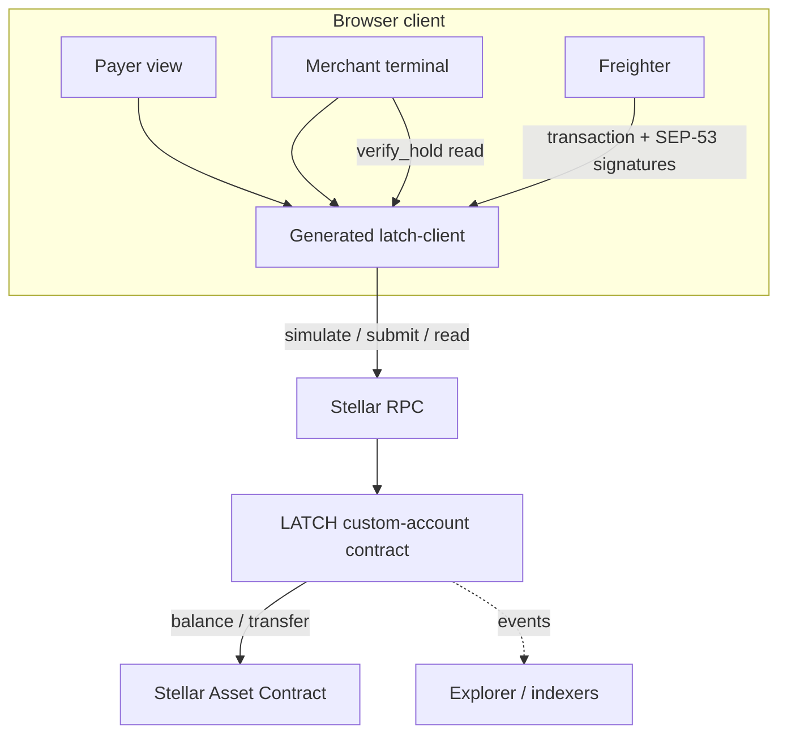
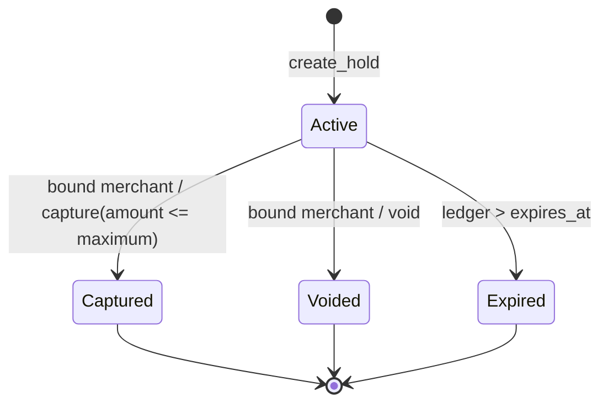
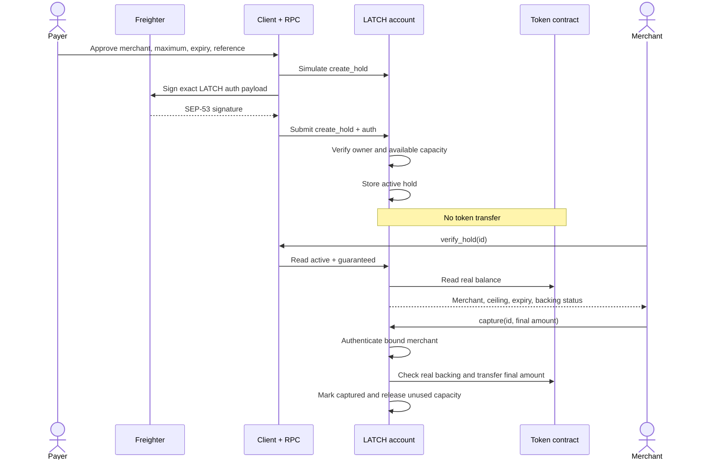
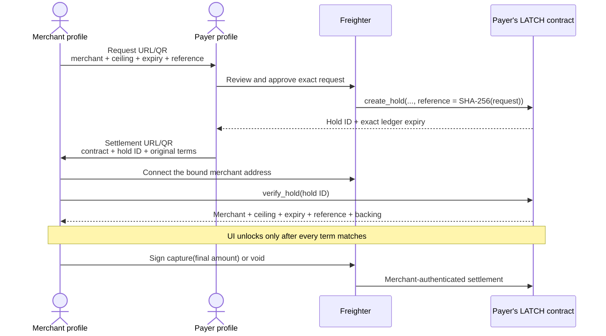

# LATCH architecture

This document describes the architecture implemented in this repository and
deployed on Stellar Testnet. It is intentionally narrower than the long-term
product vision.

When documents disagree, use this order of authority:

1. deployed contract and source code;
2. [`PRODUCT-DECISIONS.md`](./PRODUCT-DECISIONS.md);
3. this architecture document;
4. the locked pre-build [`LATCH-PRD.md`](../LATCH-PRD.md).

## 1. System goal

LATCH makes an authorization hold a property of the payer's own Stellar
contract account.

A hold commits four facts:

- the merchant allowed to settle it;
- the maximum settlement amount;
- the expiration ledger;
- a 32-byte external reference.

Creating that record transfers no token. Instead, the account removes the
maximum from capacity available to owner-initiated payments. The merchant may
later capture once for any non-negative amount up to the ceiling, or release
the hold without settlement. The unused portion becomes available in the same
terminal transaction.

The system does **not** attempt to provide dispute resolution, issuer-risk
protection, recurring payments, a general escrow, or a production merchant
acquiring stack.

## 2. System context



### Component responsibilities

| Component | Responsibility | Explicitly not responsible for |
|---|---|---|
| LATCH contract | Authorization policy, reservations, accounting mirror, settlement, verification | Key custody, issuer controls, user interface |
| Stellar Asset Contract | Canonical token balance and transfers | Understanding holds or merchant intent |
| Freighter | Owner key custody and user-approved signatures | Enforcing reservation accounting |
| Generated client | Typed contract calls, simulation, signing, submission | Deciding whether a hold is trustworthy |
| Payer view | Request review, authorization, balance/capacity display | Holding private keys |
| Merchant terminal | Request creation, verification, capture/release controls | Custody before capture |
| Proof manifest | Reproducible IDs, hashes, balances, and explorer links | Live state or security authority |

There is no application backend in the current prototype. Static frontend code
talks directly to Stellar RPC. Browser storage contains only the public live
contract ID and demo phase metadata; it never contains a private key.

## 3. Core accounting invariant

Let:

```text
R = sum(maximum of every active, non-expired hold)
M = internal mirror balance
B = real balance reported by the configured Stellar Asset Contract

backing   = min(M, B)
available = max(0, backing - R)
```

The contract requires:

```text
new hold maximum <= available
owner payment     <= available
post-capture backing >= reservations belonging to every other merchant
```

Using the lower of `M` and `B` is deliberate:

- If tokens arrive outside `deposit`, the mirror remains lower and the account
  understates capacity until `sync`; it does not make an unsafe promise.
- If clawback or another asset-level action lowers the real balance, execution
  immediately uses that lower value even before `sync`.
- If backing is below aggregate reservations, `available` saturates at zero and
  `verify_hold` stops reporting active holds as guaranteed.

“Guaranteed” therefore means **payer-side capacity is currently reserved and
backed**. It does not mean the asset issuer cannot freeze or claw back tokens.

## 4. State model

Each hold has one live state and three observable terminal outcomes. Expiry is
evaluated lazily from ledger sequence; it does not require a keeper transaction.



Terminal states cannot transition again. A capture is terminal even when it is
less than the maximum; the unused difference is released immediately. The v1
contract does not support multiple partial captures.

### Persistent state

| Key | Type | Purpose |
|---|---|---|
| `Owner` | `BytesN<32>` | Ed25519 public key that controls owner-authorized calls |
| `Token` | `Address` | Single Stellar Asset Contract configured at construction |
| `MirrorBalance` | `i128` | Internal accounting balance available during custom auth |
| `Holds` | `Map<u64, Hold>` | Bounded hold registry |
| `NextHoldId` | `u64` | Monotonic identifier allocation |

The registry allows at most 16 simultaneously active holds. Once the map reaches
64 stored entries, creation compacts terminal and expired history and retains
only live reservations. Historical terminal evidence remains available through
contract events. Hold duration is capped at 120,960 ledgers.

Mutating calls extend instance TTL to reduce accidental archival risk.

## 5. Authorization architecture

LATCH implements Soroban's `CustomAccountInterface`. Owner-authorized calls use
the LATCH C-address as the required authority while an Ed25519 G-account key is
stored as the owner.

### Owner signing path

1. The client asks RPC to simulate the intended transaction.
2. The generated authorization entry contains the network, nonce, expiration,
   contract address, function, and arguments.
3. Freighter signs a domain-separated SEP-53 message containing the exact
   authorization payload digest.
4. The client attaches that signature to the LATCH authorization entry and the
   wallet signs the transaction envelope.
5. On-chain `__check_auth` reconstructs the signed-message digest and verifies
   the Ed25519 signature against `Owner`.
6. The policy validates every authorization context before function execution
   is accepted.

The application receives signatures, never private keys.

### Default-deny policy

`__check_auth` accepts only these LATCH self-call functions:

- `create_hold(...)`
- `pay(..., amount)`

The contract entrypoints still perform typed argument, amount, expiry, ceiling,
and backing validation. For batched authorization contexts, all requested
`pay` amounts are summed with checked arithmetic and compared with mirror-based
available capacity. The policy rejects:

- any other self-call;
- direct calls to the configured token contract;
- calls to unrelated contracts;
- contract-creation host-function contexts;
- invalid signatures, invalid amounts, or aggregate outflow beyond capacity.

`deposit` is authorized by the external funding address. `capture` and `void`
require the merchant address stored in the hold. Read-only methods require no
authorization.

## 6. Why the mirror exists

The mirror is a runtime requirement, not a cache added for speed.

During a token transfer from a contract account, Soroban may call that
account's `__check_auth`. Calling the same Stellar Asset Contract again from
inside `__check_auth` to read its balance would re-enter the active token
contract frame, which the host rejects. The authorization policy therefore
needs an internal, storage-only balance view.

The implementation separates two checks:

| Layer | Data available | Safety role |
|---|---|---|
| `__check_auth` | Mirror + hold storage | Reject forbidden call shapes and owner outflow through reserved capacity |
| Function body | Mirror + real SAC balance | Repeat capacity/backing checks and protect against stale mirror or clawback |

Mirror writes happen in ordinary function bodies, not inside `__check_auth`.
Soroban recording-mode simulation does not execute custom auth, so auth-time
writes would be absent from the transaction footprint and could fail only after
the user signs. Body writes are recorded during simulation and preserve the
normal `simulate → sign → submit` transaction flow.

Five isolated spike crates test these host assumptions against
`soroban-env-host 27.0.1`:

| Spike | Question answered |
|---|---|
| `spike-reentry` | SAC re-entry behavior inside custom authorization |
| `spike-s1` | Nested self-transfer and invoker-contract authorization |
| `spike-s2` | Relay/intermediary authorization contexts |
| `spike-s3` | Sibling auth ordering, rollback, and recording behavior |
| `spike-s6` | Read-only custom auth with body-written balance accounting |

## 7. Transaction flows

### Create and settle a hold



### Direct owner payment

`pay` is the adversarial path that makes a hold meaningful:

1. RPC simulation constructs the LATCH authorization payload.
2. The owner signs through Freighter.
3. `__check_auth` rejects forbidden contexts and checks the aggregate requested
   outflow against mirror-based available capacity.
4. `pay` recomputes effective available capacity using
   `min(mirror, real balance)`.
5. Only then does the token transfer execute and the mirror decrease.

If the amount exceeds available capacity during simulation, the client does not
ask for a signature or submit a failing transaction. The demo proves this with
before/after reads and labels it as a simulation rejection—not an on-chain
failed transaction.

### Capture and release

Only the recorded merchant can call either terminal operation:

- `capture(id, amount)` checks liveness, ceiling, and backing for all other
  holds; transfers `amount`; marks the hold captured; releases
  `maximum - amount` atomically.
- `void(id)` checks liveness, marks the hold voided, and transfers nothing.

Expiration also removes a hold from aggregate reserved capacity when state is
read, but no `Expired` write or event is emitted solely because time advanced.

## 8. Verification semantics

`verify_hold(id)` returns:

```text
active
guaranteed
merchant
maximum
expires_at
reference
```

The result is calculated from current ledger and token state:

```text
active     = stored status is Active AND current ledger <= expires_at
guaranteed = active AND min(mirror, real balance) >= total active reservations
```

This is deliberately stricter than checking whether the queried hold exists.
Every active merchant claim must be backed before any one of them is presented
as guaranteed.

## 9. Events and evidence

Events make accounting outcomes reconstructable without interpreting opaque
host failures:

| Event | Evidence payload |
|---|---|
| `Initialized` | owner, token |
| `Deposited` | source, amount, new mirror |
| `HoldCreated` | hold ID, merchant, maximum, expiry |
| `Paid` | destination, amount, new available capacity |
| `HoldCaptured` | hold ID, merchant, settled amount, released amount |
| `HoldVoided` | hold ID, merchant |
| `BalanceSynced` | old mirror, new mirror |

The current public proof is pinned in
[`deployments/testnet.json`](../deployments/testnet.json):

| Artifact | Value |
|---|---|
| Network | Stellar Testnet |
| LATCH contract | [`CCPQ2PBP7CYUP5FPKHJPOBGGI6WQZ7VOWKJY4HYWO2FTRU2TMGJ4JPWU`](https://stellar.expert/explorer/testnet/contract/CCPQ2PBP7CYUP5FPKHJPOBGGI6WQZ7VOWKJY4HYWO2FTRU2TMGJ4JPWU) |
| Asset | LUSD test asset |
| Optimized WASM | 15,156 bytes |
| WASM SHA-256 | `d80feb4ff5eb56d62d8b8fca3fa04d7f404d453298fded9ef2cd2298df3a590d` |
| Final state | balance 37.60 · reserved 0 · available 37.60 |

Testnet is test evidence, not a production deployment or security endorsement.

## 10. Frontend and client architecture

The browser demo is a static TypeScript application bundled with esbuild.

- The contract ABI client is generated by Stellar CLI into
  `packages/latch-client`.
- A deterministic sync step vendors the generated package into the standalone
  demo and CI rejects drift.
- Network and proof constants originate in `config/testnet.mjs` and
  `deployments/testnet.json`; generated frontend configuration is drift-checked.
- Merchant requests encode network, asset, merchant, amount, expiry delta, and
  reference into a URL-safe payload. Its SHA-256 digest is shown as the
  authorization ID and stored as the hold's on-chain `reference`.
- After creation, the payer returns a second URL-safe payload containing the
  LATCH contract, hold ID, exact expiry, merchant, ceiling, and request ID.
  The merchant treats every field as untrusted until `verify_hold` returns a
  matching active and backed hold.
- Live session recovery is keyed by the connected public address in browser
  storage. Invalid stored shapes are rejected.

The request and settlement QR codes are transport mechanisms, not signatures.
The payer's explicit on-chain authorization creates the reservation; the bound
merchant's Freighter signature authorizes its terminal settlement.

### Browser-to-browser handoff



There is no rendezvous server in this prototype. URL fragments are not used;
the payload is carried in a query parameter so profiles can exchange it by QR
or copy/paste. Because transport data can be edited, the merchant UI never
derives a guarantee from the URL itself: it checks the connected G-address and
re-reads all security-relevant terms from the C-address on Testnet.

### Two proof modes

| Mode | Purpose | Source of truth |
|---|---|---|
| Verified replay | Fast, deterministic explanation of the two-merchant LUSD lifecycle | Checked-in Testnet transaction manifest |
| Live wallet | Real deployment and signing with judge-controlled Testnet XLM | Current RPC reads and submitted transactions |

Replay is not presented as the connected wallet's activity. Live mode supports
separate merchant and payer profiles through the two-link handoff. The shorter
one-wallet route remains a labeled stage-recovery path, not the canonical
merchant integration.

## 11. Failure and retry semantics

The client distinguishes three outcomes:

| Outcome | Meaning | Retry rule |
|---|---|---|
| Typed simulation rejection | Policy rejected before signing/submission | Safe after changing intent or state |
| Submitted success | Transaction is final and state must be refreshed | Do not repeat blindly |
| Ambiguous RPC/network error | Submission status may be unknown | Refresh chain state before retrying |

The UI never treats an unavailable `verify_hold` read as proof. It displays
verification as delayed and makes no guarantee claim. A failed or throttled
network therefore degrades visibility, not the contract's invariant.

## 12. Trust boundaries and residual risk

| Boundary | Enforced by LATCH | External assumption or residual risk |
|---|---|---|
| Owner key | Signature must match exact auth payload | Freighter/key custody and user approval integrity |
| Owner spending | Reserved capacity cannot be spent through accepted account calls | Bugs in Stellar host or contract implementation |
| Merchant settlement | Only bound merchant; one terminal capture; amount capped | Merchant chooses final amount within authorized ceiling |
| Token backing | Lower of mirror and real balance is used; loss is reported | Issuer freeze, clawback, or authorization controls |
| Expiration | Ledger sequence determines liveness | Ledger timing is approximate wall-clock time |
| RPC | Reads and simulations drive the UI | Provider availability and latency |
| Frontend | No private-key custody; typed ABI client | Supply-chain/browser compromise remains possible |

The prototype has not received an independent production audit. Its current
security claim is narrower: controls are explicit, protocol assumptions are
isolated in executable spikes, and the threat matrix maps those controls to
tests in [`SECURITY-EVIDENCE.md`](./SECURITY-EVIDENCE.md).

## 13. Build and verification pipeline

Every GitHub Actions run performs:

1. Rust formatting and Clippy with warnings denied;
2. 15 production contract tests;
3. 14 tests across five protocol spike crates;
4. optimized WASM build;
5. ABI client regeneration and drift detection;
6. frontend configuration/vendor drift detection;
7. frontend lint, 15 tests, typecheck, and production bundle;
8. committed bundle drift detection.

The Testnet lifecycle is intentionally a separate explicit command because it
creates funded identities and public network state:

```sh
npm run testnet:bootstrap
```

It builds the final WASM, regenerates the client, deploys a fresh account, runs
the two-hold lifecycle, checks the rejected spend and final balances, and writes
the resulting hashes to the proof manifest.

## 14. Architectural trade-offs

| Decision | Benefit | Cost |
|---|---|---|
| One asset per account | Small state and clear invariant | Multi-asset users need separate accounts |
| Single terminal capture | Simple replay protection and accounting | No incremental settlement |
| One bounded hold map | Predictable storage access | Active holds capped at 16; history compacts |
| Internal balance mirror | Custom auth remains storage-only | Requires reconciliation for external token movements |
| Merchant-only release | Payer cannot revoke a promise after service begins | Merchant cooperation or expiry is required |
| Static client, no backend | Small trust surface and easy deployment | No notifications, indexing service, or merchant identity layer |

These are v1 scope decisions, not hidden production claims. The next
architecture milestone is a small merchant integration layer plus event-indexed
status history, without changing the on-chain invariant.
