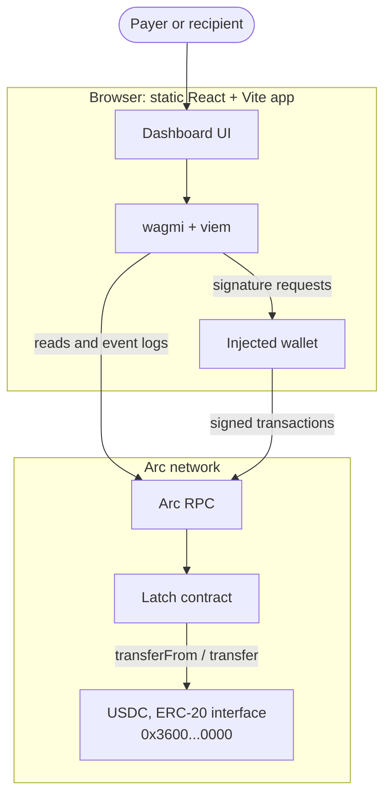
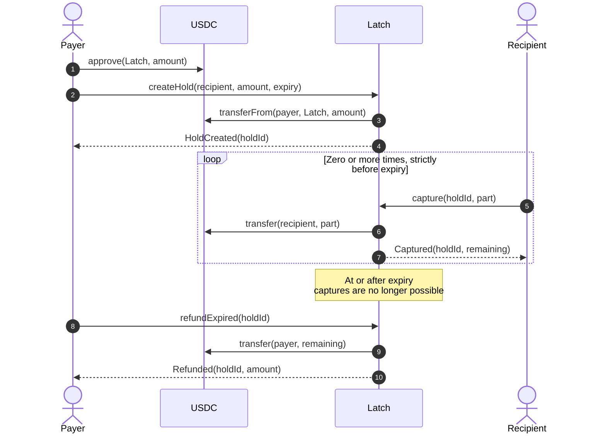
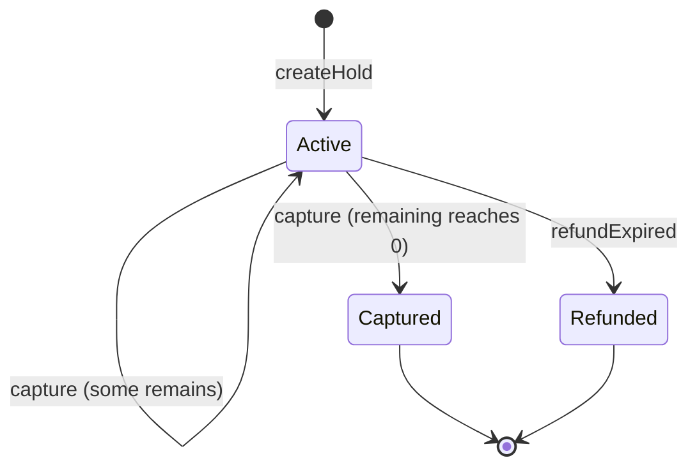

# Architecture

[README](../README.md) · [Deployments](reference/DEPLOYMENTS.md) · [Security](reference/SECURITY.md) · [Demo](guides/DEMO.md) · [Deployment guide](guides/DEPLOYMENT.md)

LATCH is one immutable smart contract and a static web app that reads and writes it. There is no backend, no database and no indexer. Everything the interface shows comes from the chain, through the browser's own RPC connection.

- [System architecture](#system-architecture)
- [Authorization lifecycle](#authorization-lifecycle)
- [Contract rules and design decisions](#contract-rules-and-design-decisions)
- [How the frontend reads the chain](#how-the-frontend-reads-the-chain)
- [Network selection](#network-selection)
- [Source map](#source-map)

## System architecture



| Component | Role | Source |
| --- | --- | --- |
| Dashboard UI | Create form, holds table, selected-hold view, transaction history | [`src/components`](../src/components) |
| wagmi + viem | Contract reads, event logs, transaction submission, chain switching | [`src/hooks`](../src/hooks), [`src/config.ts`](../src/config.ts) |
| Injected wallet | Holds the user's key. The app never sees a private key | [`src/config.ts`](../src/config.ts) |
| Arc RPC | JSON-RPC endpoint for the selected network | [`src/config.ts`](../src/config.ts) |
| Latch contract | Escrows USDC and enforces every rule | [`contracts/Latch.sol`](../contracts/Latch.sol) |
| USDC | Arc's USDC through its 6-decimal ERC-20 interface | [Arc contract addresses](https://docs.arc.io/arc/references/contract-addresses.md) |

The frontend is built to static files and hosted on any static host (see the [Vercel guide](guides/VERCEL.md)). It does not hold funds and cannot move anyone's USDC. Every state change is a transaction signed by the user's wallet.

On Arc, USDC is also the native gas token. LATCH only uses the ERC-20 interface, in 6-decimal base units (1 USDC = `1_000_000`). The same balance is shown with 18 decimals in the native view that pays for gas, and the app never mixes the two.

## Authorization lifecycle

A hold is one authorization: a payer, a named recipient, an amount and an expiry.



Example from the [demo](guides/DEMO.md): reserve 0.02 USDC, capture 0.01 USDC before expiry, then after expiry the payer refunds the remaining 0.01 USDC. The same flow is the test `test_DemoFlow_ReserveCapturePartialThenRefundRemainder` in [`contracts/test/Latch.t.sol`](../contracts/test/Latch.t.sol).

If the recipient captures everything, the hold is finished and there is nothing to refund. If the recipient captures nothing, the payer refunds the full amount after expiry.

## Contract rules and design decisions

### Roles and permissions

| Function | Who may call | When | Effect |
| --- | --- | --- | --- |
| `createHold(recipient, amount, expiry)` | Anyone (becomes the payer) | `expiry` is later than the current block time | Pulls `amount` USDC from the payer, stores a new hold, returns a sequential `holdId` starting at 1 |
| `capture(holdId, amount)` | Only the hold's recipient | Strictly before `expiry` | Sends `amount` USDC to the recipient |
| `refundExpired(holdId)` | Only the hold's payer | At or after `expiry` | Sends all remaining USDC back to the payer |

`createHold` rejects the zero address, a recipient equal to the payer, a zero amount, and an expiry that is not in the future. `capture` rejects a zero amount and any amount above what remains. `refundExpired` rejects a hold with nothing left. There is no owner, admin, pause, fee, upgrade or rescue function, so nobody can move funds except through these three functions.

### State transitions



`Captured` and `Refunded` are final. There is no cancel, extend or top-up. Expiry itself does not write to storage: a hold stays `Active` on-chain after its deadline until the payer refunds it. The interface shows such a hold as **Expired** (still `Active` on-chain, now at or past `expiry`), which is a display state computed in [`src/lib/latch.ts`](../src/lib/latch.ts), not a contract state.

### Expiry behavior

Capture and refund never overlap. At `block.timestamp < expiry` only the recipient can capture. From `block.timestamp >= expiry` only the payer can refund. The boundary second belongs to the refund side. Expiry uses block timestamps, which validators can shift by a few seconds.

### Partial capture and accounting invariant

A hold can be captured in as many steps as the recipient likes. Each hold stores `deposited`, `captured` and `refunded`, and `remaining` is derived:

```text
deposited = captured + refunded + remaining
```

The invariant holds for every hold at every point in time. Across the whole contract, the USDC balance of Latch equals the sum of `remaining` over all holds, plus any USDC that someone sent to the contract directly. Such stray transfers are not tracked and cannot be recovered, because no function can move them.

The Foundry suite checks this with fuzz tests and handler-based invariant tests (token conservation, per-hold accounting, status consistency). See [`contracts/test`](../contracts/test).

### Other decisions

- **Reentrancy and ordering.** All three state-changing functions are `nonReentrant`, update storage before moving tokens, and use OpenZeppelin `SafeERC20`.
- **Exact deposits.** `createHold` measures the contract's USDC balance before and after the transfer and reverts if the difference is not exactly `amount`. A token that charges a transfer fee therefore cannot create an under-collateralized hold.
- **Funds only go to the parties.** Captures go to the recipient and refunds go to the payer. No one else can redirect them, and only the payer triggers a refund.
- **Exact-amount approval.** The interface approves exactly the amount being reserved rather than an unlimited allowance, so each reservation is two transactions.
- **Events.** `HoldCreated(holdId, payer, recipient, amount, expiry)`, `Captured(holdId, recipient, amount, remaining)` and `Refunded(holdId, payer, amount)` index the hold ID and the addresses.
- **Known limits.** USDC is centrally issued, so a blocklisted address can fail to receive funds. See [SECURITY](reference/SECURITY.md).

## How the frontend reads the chain

The app has two read paths, both straight from the RPC. Neither requires a server.

| Data | Method | Details | Source |
| --- | --- | --- | --- |
| Current holds | `holdCount()` then `getHold(id)` for the latest 60 ids in one batched read | Polled every 5 seconds. Older holds stay usable on-chain but are not listed | [`useHolds.ts`](../src/hooks/useHolds.ts) |
| Transaction history | `eth_getLogs` for the three events | Starts at the configured deployment block, or the latest 100,000 blocks if that is later. Ranges start at 5,000 blocks and halve (down to 250) if the RPC refuses one. Polled every 8 seconds | [`useActivity.ts`](../src/hooks/useActivity.ts) |

Writes go through [`useTx.ts`](../src/hooks/useTx.ts), which switches the wallet to the configured Arc network first, then reports honest phases: waiting for the wallet signature, waiting for confirmation, success or failure. Transaction and address links are built from the selected network's explorer.

Totals on the overview (reserved, captured, available to refund) are computed in the browser from the holds the signed-in wallet created. If the wallet is not connected or the data is still loading, the interface shows an empty or loading state rather than a number.

## Network selection

The app targets exactly one network, chosen at build time by public environment variables. See [`.env.example`](../.env.example) and [`src/lib/latch.ts`](../src/lib/latch.ts).

| Variable | Purpose |
| --- | --- |
| `VITE_LATCH_NETWORK` | `mainnet` (chain ID 5042) or `testnet` (chain ID 5042002) |
| `VITE_LATCH_ADDRESS_MAINNET`, `VITE_LATCH_DEPLOY_BLOCK_MAINNET` | Contract and deployment block on Arc Mainnet |
| `VITE_LATCH_ADDRESS_TESTNET`, `VITE_LATCH_DEPLOY_BLOCK_TESTNET` | Contract and deployment block on Arc Testnet |

Production builds read `mainnet` from the committed [`.env.production`](../.env.production). The chain, contract, USDC address, wallet network check and every explorer link derive from that one selection. Safety checks refuse ambiguous setups instead of guessing:

- A production build with no network set shows a configuration error.
- Mainnet with a missing or invalid address talks to no contract. It never falls back to testnet.
- The known testnet contract is refused as a mainnet address, and the known mainnet contract is refused as a testnet address.

When the app targets mainnet it shows an "Arc Mainnet" badge and a real-USDC warning.

## Source map

| Area | Files |
| --- | --- |
| Contract | [`contracts/Latch.sol`](../contracts/Latch.sol) |
| Contract tests | [`contracts/test`](../contracts/test) (unit, reverts, fuzz, invariants) |
| Deploy script | [`contracts/script/DeployLatch.s.sol`](../contracts/script/DeployLatch.s.sol) |
| Frontend ABI, addresses, status logic | [`src/lib/latch.ts`](../src/lib/latch.ts) |
| Chain configuration | [`src/config.ts`](../src/config.ts), [`src/lib/network.ts`](../src/lib/network.ts) |
| Data hooks | [`src/hooks`](../src/hooks) |
| Stylesheet build | [`vite.latch-css.ts`](../vite.latch-css.ts) |
